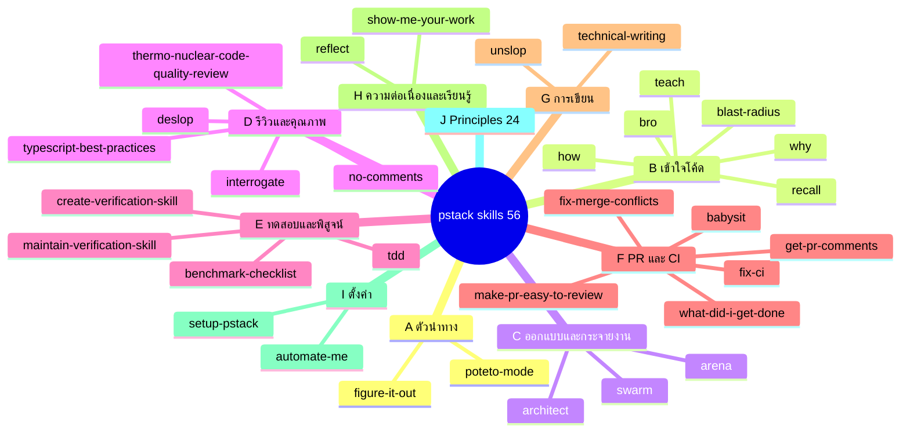
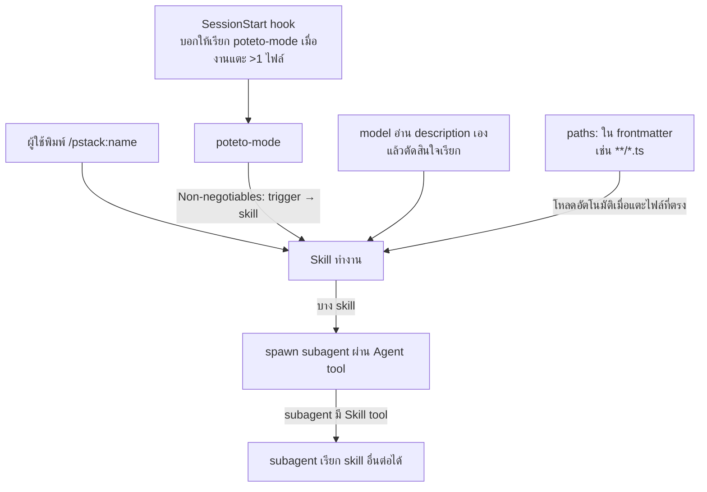
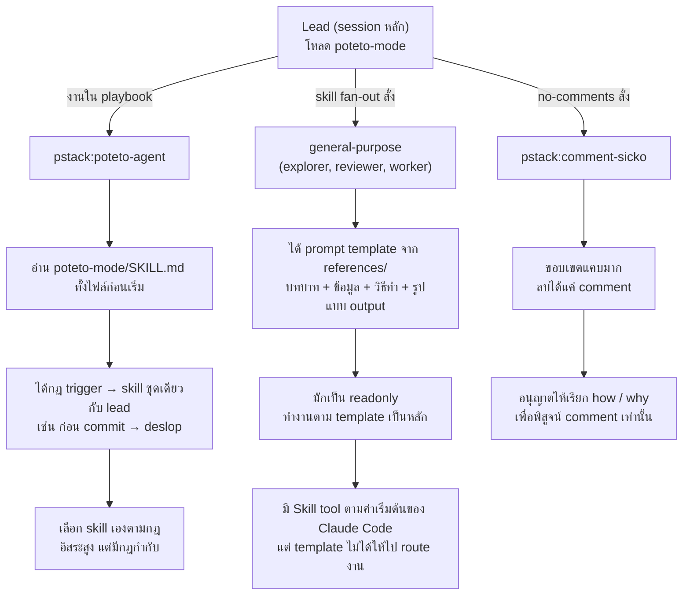
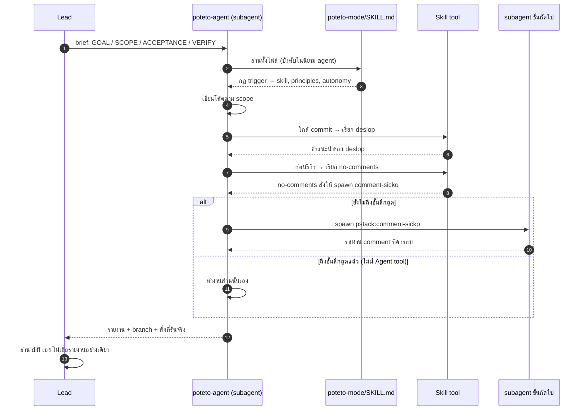

# สรุป Skill ทั้งหมดของ pstack แบบเข้าใจง่าย และ subagent เลือกใช้ skill เองได้ไหม

[← กลับไปหน้ารวม](README.md)

> **ที่มา:** อ่านจาก `pstack-claude-main/plugins/pstack/skills/*/SKILL.md` ทั้ง 56 โฟลเดอร์ (เวอร์ชัน `0.9.64`) และ `docs/reference.md` ส่วนเรื่องกลไกของ Claude Code อ้างจากเอกสารทางการ [Subagents](https://code.claude.com/docs/en/sub-agents) และ [Skills](https://code.claude.com/docs/en/skills) ที่เปิดอ่านเมื่อ 2026-11-14
>
> **ป้ายกำกับ:** **[โค้ด]** คืออ่านเจอในไฟล์ของ pstack **[เอกสาร]** คืออ่านเจอในเอกสารของ Claude Code **[อนุมาน]** คือการตีความของผู้เขียน ยังไม่ได้รัน skill ใดจริง
>
> **ต่างจาก [คู่มือ Skill ทั้งหมด](PSTACK-SKILLS-CATALOG-TH.md) อย่างไร:** ไฟล์นี้เน้นภาษาง่าย บอกว่าแต่ละตัวเหมาะกับงานแบบไหน ส่ง subagent หรือเปล่า และมีหัวข้อเรื่องการเลือก skill ของ subagent โดยเฉพาะ

---

## สารบัญ

1. [สรุปสั้น](#1-สรุปสั้น)
2. [ภาพรวม: skill 56 ตัวแบ่งเป็นกลุ่มอะไรบ้าง](#2-ภาพรวม-skill-56-ตัวแบ่งเป็นกลุ่มอะไรบ้าง)
3. [skill ถูกเรียกใช้ได้กี่ทาง](#3-skill-ถูกเรียกใช้ได้กี่ทาง)
4. [กลุ่ม A: ตัวนำทาง](#4-กลุ่ม-a-ตัวนำทาง)
5. [กลุ่ม B: ทำความเข้าใจโค้ดและบริบท](#5-กลุ่ม-b-ทำความเข้าใจโค้ดและบริบท)
6. [กลุ่ม C: ออกแบบและกระจายงาน](#6-กลุ่ม-c-ออกแบบและกระจายงาน)
7. [กลุ่ม D: รีวิวและคุมคุณภาพโค้ด](#7-กลุ่ม-d-รีวิวและคุมคุณภาพโค้ด)
8. [กลุ่ม E: ทดสอบและพิสูจน์ผล](#8-กลุ่ม-e-ทดสอบและพิสูจน์ผล)
9. [กลุ่ม F: งาน PR และ CI](#9-กลุ่ม-f-งาน-pr-และ-ci)
10. [กลุ่ม G: การเขียน](#10-กลุ่ม-g-การเขียน)
11. [กลุ่ม H: ความต่อเนื่องและการเรียนรู้ของระบบ](#11-กลุ่ม-h-ความต่อเนื่องและการเรียนรู้ของระบบ)
12. [กลุ่ม I: ตั้งค่าและปรับให้เป็นของตัวเอง](#12-กลุ่ม-i-ตั้งค่าและปรับให้เป็นของตัวเอง)
13. [กลุ่ม J: Principles 24 ตัว](#13-กลุ่ม-j-principles-24-ตัว)
14. [ตารางเลือก skill ตามสถานการณ์](#14-ตารางเลือก-skill-ตามสถานการณ์)
15. [Subagent เลือกใช้ skill เองได้ไหม](#15-subagent-เลือกใช้-skill-เองได้ไหม)
16. [นำไปใช้กับ subagent ของคุณ](#16-นำไปใช้กับ-subagent-ของคุณ)

---

## 1. สรุปสั้น

- pstack มี **56 skill** แบ่งเป็น **public skill 32 ตัว** ที่ผู้ใช้พิมพ์เรียกได้ และ **principle 24 ตัว** ที่เป็นหลักคิดให้ agent เปิดอ่านเอง ผู้ใช้เรียกตรงไม่ได้ **[โค้ด]**
- ตัวสำคัญที่สุดคือ `poteto-mode` ซึ่งเป็นตัวนำทาง เลือก playbook และบอกว่าเมื่อไรต้องเรียก skill ตัวไหน **[โค้ด]**
- skill หลายตัวไม่ได้ทำงานเอง แต่ **ส่ง subagent ไปทำ** เช่น `how`, `why`, `arena`, `swarm`, `interrogate`, `reflect` และ `no-comments` **[โค้ด]**
- **subagent เลือกใช้ skill เองได้** ใน Claude Code subagent มี `Skill` tool และค้นหา skill เองได้ ถ้าไม่ได้ถูกถอด tool นี้ออก **[เอกสาร]** แต่ pstack ไม่ได้ปล่อยให้เลือกตามใจ subagent ตัวหลักต้องอ่านกฎ trigger → skill ใน `poteto-mode` ก่อน ส่วน worker ของ skill แบบ fan-out ได้ prompt template ที่บอกงานชัดเจนมาแล้ว **[โค้ด]** รายละเอียดอยู่ใน [หัวข้อ 15](#15-subagent-เลือกใช้-skill-เองได้ไหม)

---

## 2. ภาพรวม: skill 56 ตัวแบ่งเป็นกลุ่มอะไรบ้าง



| กลุ่ม | จำนวน | หน้าที่ |
|---|---|---|
| A ตัวนำทาง | 2 | เลือก workflow ที่เหมาะกับงาน |
| B เข้าใจโค้ด | 6 | อธิบายว่าโค้ดทำงานอย่างไร ทำไมเป็นแบบนี้ และกระทบอะไร |
| C ออกแบบและกระจายงาน | 3 | ออกแบบก่อนเขียน และให้หลาย agent ทำงานขนานกัน |
| D รีวิวและคุณภาพ | 5 | หาจุดผิด และทำความสะอาดโค้ด |
| E ทดสอบและพิสูจน์ | 4 | test ก่อนแก้ ตรวจตัวเลข และสร้างเครื่องมือขับแอปจริง |
| F PR และ CI | 6 | ดูแล PR ให้เขียว และสรุปงาน |
| G การเขียน | 2 | ภาษาที่ไม่เหมือน AI เขียน และมาตรฐานเอกสารเทคนิค |
| H ความต่อเนื่อง | 2 | บันทึกการตัดสินใจ และเรียนรู้จากงานที่ทำ |
| I ตั้งค่า | 2 | เลือกโมเดล และสร้าง skill สไตล์ของตัวเอง |
| J Principles | 24 | หลักคิดที่เปิดอ่านเมื่อเข้าเงื่อนไข |

---

## 3. skill ถูกเรียกใช้ได้กี่ทาง



| ทาง | อธิบาย | ตัวอย่าง |
|---|---|---|
| ผู้ใช้พิมพ์เอง | Claude Code ใช้ `/pstack:<name>` ส่วน Pi ใช้ `/skill:<name>` **[โค้ด]** | `/pstack:how` |
| Hook ชี้ทาง | hook ตอนเริ่ม session บอกให้เรียก `poteto-mode` เมื่องานเข้าเงื่อนไข **[โค้ด]** | งานที่แตะมากกว่าหนึ่งไฟล์ |
| ตัวนำทางสั่ง | `poteto-mode` มีกฎแบบ "เจอสิ่งนี้ → เรียก skill นี้" **[โค้ด]** | ก่อน commit → `deslop` |
| model เลือกเองจาก `description` | "Claude uses this to decide when to apply the skill." **[เอกสาร]** | ผู้ใช้ถาม "how does X work" → `how` |
| `paths:` | โหลดเองเมื่อทำงานกับไฟล์ที่ตรง pattern **[เอกสาร]** | `typescript-best-practices` ใช้ `**/*.ts`, `**/*.tsx` **[โค้ด]** |

**frontmatter ที่กำหนดว่าใครเรียกได้ [เอกสาร]**
- `user-invocable: false` ซ่อนจากเมนู `/` ให้มีแต่ Claude ที่เรียกได้ **principle ทั้ง 24 ตัวใช้แบบนี้** **[โค้ด]**
- `disable-model-invocation: true` ห้าม Claude เรียกเอง ต้องให้คนพิมพ์ ใน pstack พบเฉพาะใน prompt stub ของ Codex ไม่ได้ใส่ใน skill หลัก **[โค้ด]**

---

## 4. กลุ่ม A: ตัวนำทาง

### `poteto-mode`
- **ทำอะไร:** เป็น "หัวหน้างาน" รับงาน เลือก playbook ที่ตรงจาก 23 แบบ เปิด todolist ที่คัดขั้นตอนมาแบบคำต่อคำ มอบงานให้ subagent ตรวจงาน และเขียนคำตอบที่ทุกข้ออ้างติดป้าย measured / inferred / guess **[โค้ด]**
- **มีอะไรอยู่ข้างใน:** กฎ trigger → skill (Non-negotiables), ดัชนี principle, ระดับอิสระ (อะไรทำเลย อะไรต้องหยุดถาม), กฎการใช้ subagent, กฎการเขียนคำตอบ, รายการ playbook, โมเดลต่อ role **[โค้ด]**
- **เหมาะกับ:** งานที่ไม่ใช่เรื่องเล็ก เช่น แก้บั๊กที่ยังไม่รู้สาเหตุ ทำฟีเจอร์ refactor หรืองานยาวหลายวัน
- **ไม่เหมาะกับ:** แก้บรรทัดเดียว ตอบคำถามสั้น ๆ หรือแก้ไฟล์เดียวที่มี test ชัด ซึ่ง hook ก็บอกให้ทำตรง ๆ **[โค้ด]**
- **ส่ง subagent:** ส่ง ใช้ `pstack:poteto-agent` สำหรับงานในขั้นตอนของ playbook **[โค้ด]**

### `figure-it-out`
- **ทำอะไร:** ออกแบบ workflow เฉพาะงาน เมื่อไม่มี playbook ไหนเข้ากัน มี 5 phase **[โค้ด]**
  1. Frame: เขียนนิยามว่าเสร็จเป็นเงื่อนไขที่พิสูจน์ได้ว่าผิด ประเมินขนาดงาน และเลือกระดับความเข้มงวด
  2. Design: แตกงานเป็นหน่วยเล็ก และสร้างเครื่องมือตรวจพร้อม baseline ก่อนเริ่มงาน
  3. Run the loop: ทำทีละหน่วยแบบการทดลอง แล้วเก็บหรือ revert
  4. Audit trail: บันทึกการตัดสินใจ
  5. Verify: ตรวจกับของจริง
- **เหมาะกับ:** migration ใหญ่, งานหลายส่วน หรืองานที่ผู้ใช้จะกลับมาตรวจทีหลัง
- **ข้อควรรู้:** ผลตรวจมี 3 ค่า คือ VERIFIED, NOT VERIFIED และ INCONCLUSIVE โดย "Inconclusive is not a pass" **[โค้ด]**

---

## 5. กลุ่ม B: ทำความเข้าใจโค้ดและบริบท

### `how` : โค้ดนี้ทำงานอย่างไร
- **ทำอะไร:** อธิบายระบบในระดับที่วิศวกรอาวุโสที่เพิ่งเข้าทีมเข้าใจได้ **[โค้ด]**
- **ขั้นตอน:**
  1. ประเมินว่าโจทย์ง่ายหรือซับซ้อน ถ้าไม่แน่ใจให้เลือกแบบง่าย
  2. ถ้าง่าย: explainer ตัวเดียวสำรวจและอธิบายในรอบเดียว
  3. ถ้าซับซ้อน: แบ่งเป็น 2-4 มุม ส่ง explorer แบบอ่านอย่างเดียวขนานกัน แล้วให้ explainer รวมผล
  4. ตัวนำนำเสนอผล แก้ได้เล็กน้อย แต่ห้ามเขียนใหม่
- **ผลลัพธ์:** Overview / Key Concepts / How It Works / Where Things Live / Gotchas
- **เหมาะกับ:** ก่อนแก้โค้ดที่ไม่คุ้น, onboarding และคำถามว่า "โค้ดนี้ควรอยู่ชั้นไหน"
- **ส่ง subagent:** ส่ง ใช้ `general-purpose` แบบ readonly ด้วยโมเดล opus เป็นค่าเริ่มต้น

### `why` : ทำไมถึงทำแบบนี้
- **ทำอะไร:** หาเหตุผลเบื้องหลังโค้ด โดยเก็บหลักฐานจากหลายแหล่งพร้อมกัน **[โค้ด]**
- **ขั้นตอน:**
  1. ระบุเป้าหมายและคำถาม
  2. ปักหมุดที่โค้ดจริงด้วย `git blame`, `git log --follow` และ `gh pr view`
  3. ดูว่ามี MCP อะไรบ้าง แล้วจับคู่กับหลักฐาน 7 ประเภท คือ source control, ticket, docs, chat, observability, error tracking และ analytics
  4. ส่ง investigator ประเภทละหนึ่งตัวขนานกัน
  5. synthesizer รวมผลตามกรอบระดับความมั่นใจ (`epistemics.md`)
- **ผลลัพธ์:** สิ่งที่พบ / สิ่งที่อนุมานได้ / สมมติฐานที่แข่งกัน / สิ่งที่ยังไม่รู้ / แหล่งที่ค้นแล้ว (รวมแหล่งที่ค้นแล้วไม่เจอ)
- **เหมาะกับ:** ก่อนลบโค้ดที่ดูแปลก, หาสาเหตุ regression และเขียน postmortem
- **ข้อดีที่ควรเรียนรู้:** "Document the null, don't skip the search." คือค้นแล้วไม่เจอก็ต้องบันทึก

### `teach` : สอนให้เข้าใจจริง
- **ทำอะไร:** รวมผลของ `how` และ `why` เป็นคำอธิบายเดียวที่เป็นภาษาคนพูด เริ่มจากนิยามง่าย ๆ แล้วค่อยลึก ใช้ diagram เป็นชุดที่ค่อย ๆ เพิ่มทีละส่วน **[โค้ด]**
- **เหมาะกับ:** "สอนผมเรื่องนี้หน่อย" หรืออยากเข้าใจ subsystem ก่อนรับงาน
- **ข้อห้าม:** ไม่ quiz ไม่ทำท่าเป็นครู และไม่แก้โค้ด

### `blast-radius` : แก้แล้วจะพังที่ไหนบ้าง
- **ทำอะไร:** หาสิ่งที่การเปลี่ยนแปลงอาจทำพังนอก diff และ **พิสูจน์ด้วยการรันโค้ดจริง** ไม่ใช่เขียนอธิบายให้ฟังดูดี **[โค้ด]**
- **หัวใจ:** หา "ข้อเท็จจริงข้อเดียวที่ทำให้มันปลอดภัย" แล้วพิสูจน์ให้ได้ ระดับความมั่นใจมี 5 ขั้น
  1. แค่พูด
  2. ชี้บรรทัด
  3. ไล่ให้เห็นว่ากรณีเสียเกิดไม่ได้
  4. รัน script จริง
  5. reproduce ในแอปจริง
- **มองไกลกว่า grep:** source ของ library, เวลาที่โค้ดรัน, JSON ที่ API คืน, column ใน DB และ feature flag
- **เหมาะกับ:** diff เล็กที่ไม่ไว้ใจ หรือ brief ที่อ้างว่า "X รองรับ Y อยู่แล้ว" ก่อนจะออกแบบตามคำอ้างนั้น

### `recall` : ทวนว่าเราทำอะไรไปแล้ว
- **ทำอะไร:** สร้างบริบทการทำงานล่าสุดกลับขึ้นมาจาก chat history ของ workspace นี้ สถานะจริงใน `git` และ `gh` และบันทึกร่วม (ticket, incident) **[โค้ด]**
- **ผลลัพธ์:** capsule ไม่เกิน 5 ข้อ, thread ที่ติดป้ายสถานะ (`[merged #N]`, `[open PR #N]`, `[in flight]` ฯลฯ), ปัญหาที่เกิดซ้ำ และขั้นถัดไปหนึ่งข้อ
- **เหมาะกับ:** "ผมทำอะไรค้างไว้" และก่อนเริ่มงานต่อ
- **ข้อควรรู้:** ห้ามอ่าน transcript ของโปรเจกต์อื่นถ้าไม่ได้ถูกขอ ส่วนถ้าจะรับช่วงจาก chat เดียว ให้ไปใช้ playbook Session pickup

### `bro` : พูดใหม่ให้เข้าใจง่าย
- **ทำอะไร:** เขียนข้อความล่าสุดใหม่โดยไม่ใช้ศัพท์เทคนิค **[โค้ด]**
- **เหมาะกับ:** เมื่อคำตอบก่อนหน้าอ่านยากเกินไป

---

## 6. กลุ่ม C: ออกแบบและกระจายงาน

### `architect` : ออกแบบก่อนเขียนโค้ด
- **ทำอะไร:** ร่าง type, signature และขอบเขตของ module โดยให้ body ยังเป็น `not implemented` ก่อน แล้วค่อยลงเนื้อ **[โค้ด]**
- **5 phase:**
  1. Ground: ใช้ `how` (และ `why` ถ้าเปลี่ยนความเป็นเจ้าของ)
  2. Sketch: ใช้ `arena` และ **ต้องมีอย่างน้อย 2 แบบที่โครงต่างกันจริง**
  3. Agree: ค่าเริ่มต้นคือไม่รอผู้ใช้ ยกเว้นผู้ใช้ขอ
  4. Implement: ใช้ sketch เป็นสัญญา ถ้าต้องเบี่ยง ต้องรายงาน
  5. Scrap: ถ้าเจอ workaround แบบเดียวกันซ้ำ ๆ ให้ทิ้ง sketch แล้วออกแบบใหม่
- **คัดแบบที่ไม่ดีทิ้งด้วย red flag 4 ข้อ:** shallow module, information leakage, temporal decomposition และ pass-through method
- **เหมาะกับ:** โค้ดที่ข้าม function boundary หรือฟีเจอร์ที่ถ้าเริ่มเขียนเลยจะล็อกรูปทรงที่ผิด

### `arena` : ให้หลายตัวแข่งกัน แล้วเลือกและผสม
- **ทำอะไร:** ส่งงานเดียวกันให้ N ตัว (ค่าเริ่มต้นคือ opus, fable, sonnet) เลือกตัวที่ดีที่สุดเป็นฐาน แล้วหยิบส่วนดีของตัวอื่นมาเสริม **[โค้ด]**
- **6 phase:**
  1. Frame: rubric 3-6 ข้อ ซึ่งผู้แข่งไม่เห็น
  2. Fan out: แต่ละตัวทำใน worktree ของตัวเอง
  3. Cross-judge: กรรมการต่างตระกูลโมเดลกับตัวนำ
  4. Pick: ตัวนำอ่านทุกชิ้นจนจบ ให้คะแนนทีละเกณฑ์
  5. Graft: หยิบ 1-2 อย่างจากตัวแพ้ มาเขียนใหม่ด้วยมือ
  6. Verify
- **กฎที่น่าสนใจ:** ทุกตัวออกมาเหมือนกัน แปลว่าเห็นตรงกัน ship ได้ ถ้าต่างกันมาก แปลว่าโจทย์ไม่ชัด ให้เขียนโจทย์ใหม่ **ห้ามเฉลี่ย**
- **เหมาะกับ:** งานที่ทำได้หลายแบบที่ถูกพอกัน เช่น โครง error handling หรือ API design
- **ข้อควรระวัง:** ใช้ token มาก เพราะมี 3 runner บวก judge อีก 1

### `swarm` : ฝูง worker ขนาน
- **ทำอะไร:** ส่ง worker N ตัวทำงานขนาน แล้วรวมเป็นรายงานเดียว **[โค้ด]**
- **3 รูปแบบ:**
  - partition: แบ่งงานคนละชิ้น
  - race: แข่งโจทย์เดียวกัน ต้องประกาศกฎเลือกก่อน (`first pass` / `rank all` / `best-of`)
  - mixed: ผสมทั้งสองแบบ
- **กฎการรวมผล:** ผลที่ไม่มี SHA หรือวิธีวัดถูกทิ้ง แล้ว spawn ใหม่ 1 ครั้ง ถ้ายังพลาดให้บันทึกเป็น gap ซึ่ง **ไม่นับว่าผ่าน**
- **รายงานของ worker:** `PASS` / `ISSUES` / `BLOCKED` พร้อมหลักฐาน
- **เหมาะกับ:** ตรวจหลายจุดพร้อมกัน เช่น coverage matrix, ตรวจ PR หลายมุม หรือ audit หลายโมดูล

---

## 7. กลุ่ม D: รีวิวและคุมคุณภาพโค้ด

### `interrogate` : ให้หลายโมเดลช่วยกันหาจุดพัง
- **ทำอะไร:** ส่ง reviewer หนึ่งตัวต่อหนึ่งโมเดล ด้วย prompt และ rubric เดียวกัน **ไม่กำหนดบุคลิก** ความเห็นต่างมาจากความต่างของโมเดล **[โค้ด]**
- **ขั้นตอน:**
  1. กำหนดขอบเขตที่จะรีวิว
  2. เขียน intent หนึ่งย่อหน้า ถ้าไม่แน่ใจให้ถามผู้ใช้
  3. spawn reviewer
  4. รวมผล ปัญหาที่ 2 โมเดลขึ้นไปเจอตรงกันคือสัญญาณแรงที่สุด
  5. ตัวนำตัดสินเป็น Act on / Consider / Noted / Dismissed
- **ข้อห้าม:** "Do NOT auto-apply changes." ผลลัพธ์คือคำตัดสิน ไม่แก้โค้ดให้
- **เหมาะกับ:** การออกแบบที่ยังเถียงกัน หรือโค้ดเสี่ยง เช่น เงิน, auth และ transaction

### `thermo-nuclear-code-quality-review` : รีวิวความดูแลง่ายแบบโหดสุด
- **ทำอะไร:** รีวิวเฉพาะเรื่องการดูแลรักษาในระยะยาวแบบเข้มงวดมาก **[โค้ด]**
- **เกณฑ์ที่ไม่ยอมผ่อน:**
  - กล้าลดโครงสร้างให้ง่ายขึ้นแบบใหญ่ ("code judo")
  - ห้ามให้ไฟล์โตจากไม่ถึง 1,000 บรรทัดเป็นเกิน 1,000 บรรทัด
  - ห้ามมี if กระจายเพิ่ม
  - โค้ดตรงไปตรงมาดีกว่าโค้ดที่ทำงานแบบมีมนตร์
  - type และ boundary ต้องสะอาด
  - logic อยู่ใน layer ที่ถูก และใช้ helper ที่มีอยู่แล้ว
- **เกณฑ์อนุมัติ:** ห้ามอนุมัติเพียงเพราะพฤติกรรมดูถูก
- **เหมาะกับ:** PR ใหญ่ที่จะอยู่ไปนาน หรือก่อน merge โค้ดหลักของระบบ

### `deslop` : ลบ "ขยะ" ที่ AI ใส่ไว้
- **ทำอะไร:** เทียบ diff กับ `main` แล้วลบสิ่งที่ AI ชอบใส่เกิน **[โค้ด]**
  - comment ที่ไม่จำเป็น
  - try/catch หรือ guard ที่ผิดปกติ
  - การ cast เป็น `any`
  - if ซ้อนลึก
- **กฎ:** ห้ามเปลี่ยนพฤติกรรม แก้ให้น้อยที่สุด และสรุป 1-3 ประโยค
- **เหมาะกับ:** ก่อน commit ทุกครั้ง (`poteto-mode` สั่งไว้)

### `no-comments` : ลบ comment ที่ไม่จำเป็น
- **ทำอะไร:** spawn subagent `pstack:comment-sicko` ซึ่งเกลียด comment มาก ให้ล่า comment ทั้งหมด แล้วตัวนำตรวจรายงานของมันก่อนยอมรับ **[โค้ด]**
- **comment ที่เก็บไว้ได้:**
  - license header
  - พฤติกรรมแปลกที่บังคับมาจากภายนอก
  - doc ของ public API
  - ลิงก์ issue หรือ RFC
- **comment ที่บอกว่า "ห้ามลบ" หรือ "ห้ามแก้":** เสนอให้เปลี่ยนเป็น type, test หรือ lint แทน
- **เหมาะกับ:** ก่อนส่งรีวิว (`poteto-mode` สั่งไว้)
- **ข้อดีที่ควรเรียนรู้:** subagent ที่บุคลิกแคบและสุดโต่ง ทำงานแคบได้ดี แต่ตัวนำต้องตรวจและปฏิเสธส่วนที่เกินขอบเขต

### `typescript-best-practices`
- **ทำอะไร:** ตารางกฎ TypeScript ได้แก่ discriminated union, branded type, `unknown` แทน `any`, ห้าม `as`, ใช้ `satisfies`, exhaustiveness ด้วย `never` และ parse ข้อมูลที่ boundary **[โค้ด]**
- **โหลดอัตโนมัติ:** มี `paths: ["**/*.ts", "**/*.tsx"]`
- **เหมาะกับ:** ทุกงานที่แตะไฟล์ TypeScript

---

## 8. กลุ่ม E: ทดสอบและพิสูจน์ผล

### `tdd` : เขียน test ที่ fail ก่อนแก้บั๊ก
- **ทำอะไร:** ทำให้บั๊กกลายเป็น test ที่ fail ก่อน แล้วค่อยแก้จนผ่าน **[โค้ด]**
- **ใช้เมื่อ:** ผู้ใช้ขอ TDD หรือบั๊กมีทาง test ที่ชัดและถูก
- **ข้ามเมื่อ:** test แพง, ต้อง mock เยอะ หรือเป็น integration ที่หนัก ในกรณีนี้ใช้ script หรือ repro แทน "Prefer no new test over a bad test"
- **จุดที่ต้องระวัง:** ต้องยกข้อความที่ fail มาให้ดู และ fail ต้องมาจากสาเหตุที่ถูก ไม่ใช่ error อื่น

### `benchmark-checklist` : ตรวจตัวเลข performance ก่อนเชื่อ
- **ทำอะไร:** คำถาม 7 ข้อก่อนรายงานตัวเลข **[โค้ด]**
  1. อะไรจำกัดมันอยู่ (ทำไมไม่เร็วกว่านี้สองเท่า)
  2. ตั้งค่าเหมือน production ไหม
  3. เกินขีดจำกัดทางกายภาพไหม
  4. มี error ไหม
  5. รันซ้ำอย่างน้อย 5 ครั้งแบบสลับ A/B แล้วได้ผลเดิมไหม
  6. มีผลกับสิ่งที่ผู้ใช้รอจริงไหม
  7. งานเกิดขึ้นจริงในช่วงที่จับเวลาไหม
- **เหมาะกับ:** ทุกครั้งที่จะบอกว่า "เร็วขึ้น X%" เช่น เทียบ PHP กับ Go

### `create-verification-skill` : สร้าง skill ที่ขับแอปจริง
- **ทำอะไร:** สำรวจ repo (ไม่ถามผู้ใช้) ว่าแอปมีหน้าตาแบบไหน รันอย่างไร ขับด้วยอะไร เก็บหลักฐานอะไร และรันหลายตัวพร้อมกันได้ไหม แล้วสร้าง `.claude/skills/verify/SKILL.md` ที่มีส่วน Launch / Doctor / Drive / Evidence / Cleanup พร้อม feature map **[โค้ด]**
- **เหมาะกับ:** โปรเจกต์ที่ยังไม่มีวิธีพิสูจน์พฤติกรรมของ UI, CLI หรือ API แบบ script
- **ทำไมสำคัญ:** playbook ของ pstack ต้องใช้ "driver skill" ในการ verify บนของจริง ถ้าไม่มี skill นี้ การ verify จะอ่อนลง **[อนุมาน]**

### `maintain-verification-skill` : ตรวจให้ verify skill ยังตรงกับของจริง
- **ทำอะไร:** ส่ง subagent อ่าน source ทีละ feature ขนานกัน แล้วตัวนำขับแอปจริงทุก feature และออก PR ที่รวมการแก้ที่พิสูจน์แล้วอย่างมากหนึ่งตัว **[โค้ด]**
- **ผลลัพธ์:** `clean`, `changed` หรือ `blocked`
- **เหมาะกับ:** รันเป็นระยะ เมื่อแอปเปลี่ยนไปมาก

---

## 9. กลุ่ม F: งาน PR และ CI

| Skill | ทำอะไร | เหมาะกับ | ข้อควรรู้ **[โค้ด]** |
|---|---|---|---|
| `babysit` | เฝ้า PR แก้ CI ตอบ review ง่าย ๆ จน mergeable | หลังเปิด PR แล้วอยากให้ดูแลต่อ | **ถ้าอยู่ใน `poteto-mode` ให้ใช้ playbook Babysit แทน skill นี้** ซึ่งเข้มกว่า มีโหมดและ watcher |
| `fix-ci` | ดู `gh pr checks` หา error แรกที่แก้ได้ แก้ให้น้อยที่สุด push แล้ววนซ้ำ | CI แดง | แก้ทีละปัญหา และใช้ `gh pr checks` เป็นแหล่งความจริง |
| `fix-merge-conflicts` | หาไฟล์ที่ conflict แก้แบบเน้นความถูกต้อง สร้าง lockfile ใหม่ด้วย tool แล้วรัน build และ test | branch มี conflict | ห้าม push หรือ tag ระหว่างแก้ |
| `get-pr-comments` | ดึงและสรุป comment ของ PR เป็น action list | อยากรู้ว่า reviewer ขออะไร | อ่านอย่างเดียว |
| `make-pr-easy-to-review` | จัด commit ใหม่ เขียน description ให้ดีขึ้น และเพิ่มคำแนะนำ reviewer | PR รก อ่านยาก | rewrite history ต้องได้รับอนุญาต และตรวจว่า tree ไม่เปลี่ยน |
| `what-did-i-get-done` | สรุป commit ของคุณในช่วงเวลาที่กำหนด | เขียน status update | ไม่เดาเจตนา บอกแค่ว่าเปลี่ยนอะไร |

---

## 10. กลุ่ม G: การเขียน

### `unslop` : ตัดสำนวนที่ฟังเหมือน AI เขียน
- **ทำอะไร:** หาและแก้ pattern ที่ทำให้ข้อความฟังเหมือน AI **[โค้ด]**
  - คำอย่าง delve, crucial, pivotal, showcase
  - "Not just X, but Y"
  - การจับกลุ่มเป็นสามข้อแบบฝืน ๆ
  - em dash
  - colon กลางประโยค
  - ตัวหนาเกินจำเป็น
  - emoji
  - คำประจบ เช่น "Great question!"
- **description บอกว่า "Must always apply."** คือใช้กับทุกข้อความที่เขียน รวมทั้งคำตอบของ agent เอง
- **เหมาะกับ:** ทุกข้อความ ทั้ง PR, commit, เอกสาร และคำตอบ

### `technical-writing` : มาตรฐานเอกสารเทคนิค
- **ทำอะไร:** มาตรฐาน 4 ชั้น **[โค้ด]**
  1. **Diátaxis:** เลือกโหมดก่อนเขียน คือ tutorial / how-to / reference / explanation
  2. **Google developer style:** เขียนถึงผู้อ่านตรง ๆ
  3. **STE:** หนึ่งประโยคหนึ่งคำสั่ง
  4. **Global English:** ไม่มีประโยคที่อ่านได้สองความหมาย
- **เหมาะกับ:** README, RFC, PR description และ commit message

---

## 11. กลุ่ม H: ความต่อเนื่องและการเรียนรู้ของระบบ

### `show-me-your-work` : บันทึกการตัดสินใจ
- **ทำอะไร:** เก็บ `decisions.tsv` ที่มี column `ts | phase | decision | why | evidence | result` แถวละหนึ่งการตัดสินใจ **[โค้ด]**
- **กฎ:**
  - append-only ห้ามแก้หรือลบแถวเก่า
  - run ใหม่ขึ้นแถว `start`
  - ตอนจบตรวจกับ transcript
  - ให้โมเดลต่างตระกูลรีวิว trail แล้วคำตอบต้องมีหัวข้อ "Attention"
- **เหมาะกับ:** งานยาว งานอัตโนมัติ หรืองานที่ผู้ใช้จะกลับมาตรวจทีหลัง

### `reflect` : เรียนรู้จากงานที่เพิ่งทำ
- **ทำอะไร:** หา transcript ของ session นี้ แล้วส่ง reviewer 3 มุมขนานกัน ได้แก่ Judgment, Tooling และ Divergent จากนั้นให้ synthesizer แบ่งผลเป็น Accepted / Rejected / Backlog **[โค้ด]**
- **ข้อที่บังคับด้วย lint หรือ script ได้:** ย้ายไป Backlog เพราะควรแก้ด้วยโครงสร้าง
- **ข้อที่ Accepted:** **ต้องให้ผู้ใช้อนุมัติก่อนแก้ skill** เพราะ "Skill changes affect every future agent"
- **เหมาะกับ:** หลังจบงานใหญ่ที่มีบทเรียน
- **เทียบกับทีมคุณ:** คล้าย retro ใน `.agents/workflows/retro.md` ที่ใช้เฉพาะแถวที่ผู้ใช้อนุมัติ

---

## 12. กลุ่ม I: ตั้งค่าและปรับให้เป็นของตัวเอง

### `setup-pstack`
- **ทำอะไร:** ตรวจว่ามีโมเดลอะไรใช้ได้ ให้ผู้ใช้เลือกโมเดลและ reasoning effort ต่อ role แล้วเขียนไฟล์ `pstack-models.md` นอกจากนี้ใช้เปิดหรือปิด hook ได้ **[โค้ด]**
- **ตัวอย่าง:** `arena runners: opus @xhigh, fable @max`, `swarm workers: inherit-parent` และ `session hook: off`
- **เหมาะกับ:** อยากลดต้นทุน เช่น ลด panel จาก 3 โมเดลเหลือ 2 หรือปิดการ route อัตโนมัติ

### `automate-me`
- **ทำอะไร:** อ่าน transcript ล่าสุดและถามผู้ใช้ แล้วร่าง skill สไตล์การทำงานของคุณเอง (`<name>-mode`) แบ่งเป็นหมวด response style, autonomy, subagents, verify และ process **[โค้ด]**
- **กฎ:** ความชอบที่พูดครั้งเดียวไม่นับ, อ้าง skill อื่นด้วย path และตั้ง `disable-model-invocation: true` เป็นค่าเริ่มต้น
- **เหมาะกับ:** อยากให้ agent ทำงานตามสไตล์ของคุณทุกครั้ง

---

## 13. กลุ่ม J: Principles 24 ตัว

principle ทุกตัวตั้ง `user-invocable: false` คือผู้ใช้ไม่ได้พิมพ์เรียก แต่ agent เปิดอ่านเมื่อเข้าเงื่อนไข และ `poteto-mode` กำหนดว่า **อ้างถึง principle ได้เฉพาะตัวที่เปิดอ่านไฟล์จริงใน session นี้แล้ว** **[โค้ด]**

| หมวด | Principle | ใช้เมื่อ | สาระสำคัญ |
|---|---|---|---|
| Core | `laziness-protocol` | กำลังจะเพิ่ม abstraction หรือ layer | เลือกการลบ และการแก้ที่เล็กที่สุด |
| Core | `foundational-thinking` | ก่อนเขียน logic | เลือก type และ data structure ให้ถูกก่อน แล้วโค้ดที่เหลือจะชัดเอง |
| Core | `redesign-from-first-principles` | มี requirement ใหม่เข้าระบบเดิม | ออกแบบเหมือนรู้ requirement นั้นมาตั้งแต่วันแรก ไม่แปะเพิ่ม |
| Core | `attack-the-premise` | แก้ซ้ำหลายรอบแล้วไม่หาย | หาสมมติฐานร่วมที่ผิด แล้วหาวิธีทดสอบมันก่อนแก้รอบต่อไป |
| Core | `subtract-before-you-add` | ก่อนเพิ่ม, refactor หรือ rewrite | ลบของที่ไม่ใช้ก่อน แล้วค่อยสร้างบนฐานที่ง่ายกว่า |
| Core | `minimize-reader-load` | โค้ดอ่านตามยาก | นับจำนวนชั้นและ state ที่ซ่อนอยู่ แล้วยุบ wrapper ที่มีผู้เรียกคนเดียว |
| Core | `outcome-oriented-execution` | migration ที่มี phase ชัด | มุ่งไปที่สถาปัตยกรรมเป้าหมาย ไม่ทำ compat layer ชั่วคราว |
| Core | `experience-first` | ต้องเลือกระหว่าง UX กับความสะดวกในการทำ | เลือกประสบการณ์ผู้ใช้ ทำฟีเจอร์น้อยแต่ดี |
| Core | `exhaust-the-design-space` | ออกแบบสิ่งใหม่ที่ไม่มีแบบอย่าง | ทำ prototype 2-3 แบบแล้วเทียบกัน |
| Core | `build-the-lever` | งานที่ไม่ใช่เรื่องเล็ก | สร้างเครื่องมือ (codemod, script, generator) ที่ reviewer รันซ้ำได้ แทนการทำด้วยมือ |
| Architecture | `model-the-domain` | logic ที่มี state หรือมี if เยอะ | ใช้ state machine, typed model หรือ registry แทน if กระจาย |
| Architecture | `boundary-discipline` | เขียน validation หรือ error handling | ตรวจที่ขอบระบบ เชื่อ type ข้างใน และเก็บ business logic เป็น pure function |
| Architecture | `type-system-discipline` | ออกแบบ type หรือ signature | ทำให้ state ที่ผิดเกิดขึ้นไม่ได้ และ parse ข้อมูลภายนอกที่ boundary |
| Architecture | `make-operations-idempotent` | คำสั่งหรือ loop ที่อาจ crash แล้ว retry | รันซ้ำแล้วได้ผลสุดท้ายเหมือนเดิม |
| Architecture | `migrate-callers-then-delete-legacy-apis` | มี API ใหม่ขณะที่ผู้เรียกเก่ายังอยู่ | ย้ายผู้เรียกแล้วลบ API เก่าในรอบเดียวกัน |
| Architecture | `separate-before-serializing-shared-state` | หลาย actor อาจเขียนที่เดียวกัน | แยกเป้าหมายการเขียนก่อน เพราะ "คำสั่งใน prompt ไม่ใช่การล็อก" |
| Verification | `prove-it-works` | ก่อนบอกว่าเสร็จ | ตรวจกับของจริง ไม่ใช่ตัวแทน และ "compile ผ่าน" ไม่นับ |
| Verification | `fix-root-causes` | debug | reproduce ก่อน ถามว่าทำไมจนถึงต้นเหตุ และไม่ใส่ guard กลบอาการ |
| Verification | `sequence-verifiable-units` | งานหลายขั้น หรือการเรียง commit และ PR | แบ่งเป็นหน่วยเล็กที่แต่ละหน่วยจบด้วยการตรวจ |
| Verification | `test-behavior-not-implementation` | เขียนหรือแก้ test | ระบุข้อบกพร่องที่ test ต้องจับได้ แล้วตรวจผลลัพธ์ที่สังเกตได้ |
| Verification | `explain-the-number` | ได้ตัวเลขที่วัดมา | หาว่าอะไรจำกัดตัวเลขนั้น และตัดความเป็นไปได้ว่าวัดผิดงาน |
| Delegation | `guard-the-context-window` | context ใกล้เต็ม | ส่งงานใหญ่ให้ subagent แล้วเก็บแค่สรุปไว้ใน thread หลัก |
| Delegation | `never-block-on-the-human` | อยากถามว่า "ทำ X ไหม" กับงานที่ย้อนได้ | ทำไปก่อน แสดงผล แล้วให้คนแก้ทีหลัง เก็บการถามไว้สำหรับงานที่ย้อนไม่ได้ |
| Meta | `encode-lessons-in-structure` | เขียนคำสั่งเดิมเป็นครั้งที่สอง | เปลี่ยนคำสั่งนั้นเป็น lint, flag, runtime check หรือ script |

---

## 14. ตารางเลือก skill ตามสถานการณ์

| สถานการณ์ | ใช้ skill | ทางเลือก |
|---|---|---|
| ไม่รู้จะเริ่มอย่างไร งานไม่เล็ก | `poteto-mode` | `figure-it-out` ถ้าไม่มี playbook เข้ากัน |
| ต้องแก้โค้ดที่ไม่คุ้น | `how` | `teach` ถ้าอยากเข้าใจลึก |
| เจอโค้ดแปลก อยากรู้ว่าทำไม | `why` | `blast-radius` ถ้าจะลบหรือแก้มัน |
| แก้ไปแล้วกลัวกระทบที่อื่น | `blast-radius` | `interrogate` ถ้าเป็นโค้ดเสี่ยง |
| ฟีเจอร์ที่ต้องออกแบบโครง | `architect` | `arena` ถ้ามีหลายแบบที่ถูกพอกัน |
| ต้องตรวจหลายจุดพร้อมกัน | `swarm` | |
| แก้บั๊กที่มี test ถูก ๆ | `tdd` | |
| วัด PHP กับ Go แล้วได้ตัวเลข | `benchmark-checklist` | |
| ไม่มีวิธีขับแอปเพื่อ verify | `create-verification-skill` | `maintain-verification-skill` เมื่อแอปเปลี่ยน |
| ก่อน commit | `deslop` | |
| ก่อนส่งรีวิว | `no-comments` | `thermo-nuclear-code-quality-review` สำหรับ PR ใหญ่ |
| เขียน PR description หรือเอกสาร | `technical-writing` + `unslop` | |
| CI แดง | `fix-ci` | |
| มี conflict | `fix-merge-conflicts` | |
| PR รก อ่านยาก | `make-pr-easy-to-review` | |
| reviewer ขออะไรบ้าง | `get-pr-comments` | |
| ผมทำอะไรค้างไว้ | `recall` | playbook Session pickup |
| งานยาวที่ไม่ได้เฝ้า | `show-me-your-work` | |
| จบงานแล้วอยากได้บทเรียน | `reflect` | |
| เขียน status update | `what-did-i-get-done` | |
| คำตอบอ่านยาก | `bro` | |
| ต้นทุนแพงไป | `setup-pstack` | |
| อยากให้ agent ทำตามสไตล์ตัวเอง | `automate-me` | |

---

## 15. Subagent เลือกใช้ skill เองได้ไหม

### 15.1 คำตอบสั้น

**ได้ ถ้าไม่ได้ถูกถอด `Skill` tool ออก แต่ pstack ออกแบบไม่ให้ subagent เลือกแบบอิสระเต็มที่**

| คำถาม | คำตอบ | ที่มา |
|---|---|---|
| subagent ใน Claude Code มี `Skill` tool ไหม | มี ถ้าไม่ได้ตัดออกด้วย `tools` หรือ `disallowedTools` | **[เอกสาร]** "without it, the subagent can still discover and invoke project, user, and plugin skills through the Skill tool during execution" |
| subagent รู้ไหมว่าตัวนำเรียก skill อะไรไปแล้ว | ไม่รู้ | **[เอกสาร]** "It doesn't see your conversation history, the skills you've already invoked, or the files Claude has already read." |
| บังคับให้ subagent มี skill ตั้งแต่เริ่มได้ไหม | ได้ ด้วยฟิลด์ `skills:` ใน frontmatter ของ agent | **[เอกสาร]** "The full content of each listed skill is injected into the subagent's context at startup" |
| ห้าม subagent ใช้ skill ได้ไหม | ได้ | **[เอกสาร]** "omit `Skill` from the `tools` list or add it to `disallowedTools`" |
| subagent ส่ง subagent ต่อได้ไหม | ได้ ลึกสุด 3 ชั้นจาก conversation หลัก | **[เอกสาร]** "up to three layers below the main conversation" ปรับได้ด้วย `CLAUDE_CODE_MAX_SUBAGENT_SPAWN_DEPTH` |
| model ตัดสินจากอะไรว่าจะใช้ skill ไหน | จาก `description` ของ skill | **[เอกสาร]** "Claude uses this to decide when to apply the skill." |

### 15.2 pstack ออกแบบเรื่องนี้อย่างไร

pstack ใช้ subagent 3 แบบ แต่ละแบบเลือก skill เองได้ไม่เท่ากัน **[โค้ด]**



**แบบที่ 1: `pstack:poteto-agent` เลือก skill เองได้ แต่ต้องอ่านกฎก่อน**
- ไฟล์นิยามมีคำสั่งเดียวคือ "Read the `poteto-mode` skill's `SKILL.md` in full before doing any work" **[โค้ด]**
- เมื่ออ่านแล้ว subagent จะมีกฎ trigger → skill ชุดเดียวกับตัวนำ จึงเลือก skill ได้เหมือนตัวนำ **[อนุมาน]**
- pstack คาดหวังให้ subagent เรียก skill เองจริง เช่น ใน `opening-a-pr.md` เขียนว่า "A subagent that opens a PR runs `interrogate`, `/deslop`, and `/no-comments`" **[โค้ด]**
- เหตุผลที่ไม่ให้ใช้ `general-purpose` แทน: "Substituting `general-purpose` skips that read and drifts" **[โค้ด]**

**แบบที่ 2: `general-purpose` ใน skill fan-out ทำตาม template**
- `how`, `why`, `swarm`, `interrogate` และ `reflect` กำหนด `subagent_type` เอง และ `poteto-mode` สั่งว่า "Respect what the skill prescribes, don't override to `poteto-agent`" **[โค้ด]**
- worker ได้ prompt template ที่ระบุบทบาท ข้อมูลที่ต้องใช้ วิธีทำ และรูปแบบ output ไว้ตายตัว หลายตัวยังตั้ง `readonly: true` ด้วย **[โค้ด]**
- เหตุผล **[อนุมาน]:** worker ประเภทนี้ต้องให้ผลในรูปแบบเดียวกันเพื่อเอามารวมหรือเทียบกันได้ ถ้าแต่ละตัวเลือก skill เอง ผลจะเทียบกันไม่ได้ และความหลากหลายควรมาจากโมเดลที่ต่างกัน ไม่ใช่จากการที่แต่ละตัวทำไม่เหมือนกัน

**แบบที่ 3: subagent ที่มีบุคลิกแคบ (`comment-sicko`)**
- ทำงานเดียว และใช้ `how` หรือ `why` ได้เฉพาะเพื่อพิสูจน์ว่า comment ควรเก็บไว้หรือไม่ **[โค้ด]**

### 15.3 Sequence: subagent เลือก skill ระหว่างทำงาน



กรณีที่ subagent ถึงชั้นลึกสุดแล้ว pstack มีกฎรองรับไว้ เช่น Feature ขั้น 4 เขียนว่า "A subagent forbidden to spawn satisfies this by owning the diff directly with the same review separation." **[โค้ด]**

### 15.4 ข้อควรระวังเมื่อปล่อยให้ subagent เลือก skill เอง

| ความเสี่ยง | ทำไม | pstack แก้อย่างไร |
|---|---|---|
| เลือก skill ผิด หรือไม่เลือกเลย | model ตัดสินจาก `description` เท่านั้น **[เอกสาร]** | ให้ subagent อ่านกฎ trigger → skill ก่อนเริ่ม **[โค้ด]** |
| ไม่รู้บริบทที่ตัวนำรู้ | subagent เริ่มด้วย context ว่าง **[เอกสาร]** | brief ต้องครบในตัว และส่ง pointer ไปยังไฟล์ **[โค้ด]** |
| คำสั่ง read-only ไม่ถูกส่งต่อ | "A delegate's children do not inherit its brief" **[โค้ด]** | บังคับด้วย `readonly` หรือการถอด tool แทนการเขียนใน prompt **[โค้ด]** |
| ต้นทุนบาน | skill fan-out ที่ subagent เรียกจะ spawn ต่ออีกหลายตัว **[อนุมาน]** | จำกัดความลึก และใช้ `setup-pstack` ลด panel **[โค้ด]** |
| skill ที่มีผลข้างเคียงถูกเรียกเอง | model อาจตัดสินใจเองว่าถึงเวลาแล้ว **[เอกสาร]** | pstack ใส่ deploy และ force-push ไว้ใน "Always pause" ส่วน Claude Code มี `disable-model-invocation: true` **[โค้ด] [เอกสาร]** |

### 15.5 สถานะในเครื่องของคุณตอนนี้
- **pstack ยังไม่ได้ติดตั้งเป็น plugin:** `~/.claude/plugins/installed_plugins.json` ไม่มี pstack และรายการ skill ใน session นี้ก็ไม่มี `pstack:*` **[วัดมา]**
- **subagent ของทีมคุณใน `.agents/agents/` ไม่มีตัวไหนตัด `Skill` ออก** analyst, git และ spec-reviewer ใช้ `disallowedTools` ตัดแค่ Edit, Write และ NotebookEdit ส่วน backend, frontend และ qa ไม่ได้ตั้ง `tools` ทุกตัวจึงเรียก skill เองได้ตามค่าเริ่มต้น **[วัดมา + เอกสาร]**
- **ยังไม่มีตัวไหนใช้ฟิลด์ `skills:`** ทุกตัวจึงต้องค้นหา skill เองระหว่างทำงาน **[วัดมา]**

---

## 16. นำไปใช้กับ subagent ของคุณ

ทั้งหมดในหัวข้อนี้เป็น **[ข้อเสนอ]** การแก้ไฟล์ใน `.agents/` หรือ gate ต้องให้ผู้ใช้อนุมัติตาม `AGENTS.md`

### 16.1 เลือกระดับอิสระในการเลือก skill ให้เหมาะกับแต่ละ role

| Role | ระดับที่แนะนำ | วิธีตั้ง | skill ที่น่าโหลดให้ล่วงหน้า |
|---|---|---|---|
| analyst | เลือกเองได้ + preload | `skills:` | `how`, `why`, `blast-radius` (ถ้าติดตั้ง pstack) |
| backend / frontend | เลือกเองได้ตามกฎ | `skills:` + กฎ trigger → skill ในไฟล์ agent | `tdd`, `deslop`, `typescript-best-practices` (ฝั่ง TS) |
| spec-reviewer | ทำตาม template | ปล่อย `Skill` ไว้ได้ แต่ระบุว่าใช้ skill อะไรได้บ้าง | `interrogate` เฉพาะงานเสี่ยง |
| qa | เลือกเองได้แบบจำกัด | `skills:` | verify skill ของโปรเจกต์, `benchmark-checklist` |
| git | ไม่ต้องใช้ skill | เพิ่ม `Skill` ใน `disallowedTools` | ไม่มี |

### 16.2 หลักการที่ยืมจาก pstack ได้ทันที
1. **ให้ subagent อ่านกฎชุดเดียวกับตัวนำ:** ทีมคุณทำอยู่แล้วโดยให้ทุก agent อ่าน `.agents/AGENTS.md` ถ้าจะให้เลือก skill เอง ให้เพิ่มตาราง "trigger → skill" ลงในไฟล์ที่ทุกตัวอ่าน
2. **ผูก skill กับ agent ด้วย `skills:`** แทนการหวังว่า model จะค้นเจอเอง เป็นวิธีเดียวกับที่ pstack ผูกการอ่าน `SKILL.md` ไว้กับ `poteto-agent`
3. **worker ที่ต้องเอาผลมารวมกันให้ใช้ template ตายตัว** เช่น reviewer หลายตัว ไม่ควรให้แต่ละตัวเลือก skill ต่างกัน
4. **บังคับด้วย tool ไม่ใช่ด้วย prompt:** ถ้าไม่อยากให้ role ไหนใช้ skill หรือ spawn ต่อ ให้ใส่ `Skill` หรือ `Agent` ใน `disallowedTools`
5. **skill ที่มีผลข้างเคียงให้ตั้ง `disable-model-invocation: true`** เช่น skill ที่ push, deploy หรือแก้ DB

### 16.3 ตัวอย่าง frontmatter (ข้อเสนอ ยังไม่ได้ทดสอบ)

```yaml
---
name: backend
description: Backend teammate. Implements tasks from an approved spec, only inside each task's scope.
model: sonnet
skills:
  - tdd
  - deslop
---
```

```yaml
---
name: git
description: Git teammate. Stages, reports the tree id, commits through the commit gate. Never pushes.
model: sonnet
disallowedTools: Edit, Write, NotebookEdit, Skill, Agent
---
```

ชื่อ skill ในตัวอย่างต้องตรงกับ skill ที่ติดตั้งอยู่จริง ถ้าติดตั้ง pstack เป็น plugin ชื่ออาจต้องมี namespace เช่น `pstack:tdd` ซึ่งยังไม่ได้ตรวจ ถ้า skill ที่ระบุไม่มีอยู่ Claude Code จะข้ามไปและเขียน warning ไว้ใน debug log **[เอกสาร]**
