# pstack จาก source code: การออกแบบ, workflow, การจัดการ agent และการเก็บ state

[← กลับไปหน้ารวม](README.md)

> **ที่มา:** สรุปจากการอ่าน source ใน `pstack-claude-main/` เวอร์ชัน `0.9.64` โดยตรง ไฟล์หลักที่อ่าน ได้แก่ `plugins/pstack/skills/poteto-mode/SKILL.md`, `hooks/`, `agents/`, `effort-agents/`, `models.json`, playbook Feature, Bug fix, Opening a PR, Babysit, Shipping, Orchestrate, Autopilot-full, Autopilot-stack, Multi-phase plan, Pause safely, Session pickup, skill `swarm`, `show-me-your-work`, `figure-it-out`, และโค้ด `scripts/orch/store.ts`, `scripts/resume.mjs`, `scripts/watch-pr/`, `pi/agents.ts`
>
> **ป้ายกำกับ:** **[โค้ด]** คือสิ่งที่อ่านเจอในไฟล์ **[อนุมาน]** คือการตีความของผู้เขียน **[ข้อเสนอ]** คือคำแนะนำสำหรับนำไปใช้ ยังไม่ได้รัน pstack จริง และ diagram ทั้งหมดวาดจากคำสั่งในไฟล์ ไม่ได้วาดจากการสังเกตตอนรัน

---

## สารบัญ

1. [สรุปสั้น](#1-สรุปสั้น)
2. [สถาปัตยกรรมชั้น](#2-สถาปัตยกรรมชั้น)
3. [pstack ทำอะไรได้บ้าง: แผนที่ playbook](#3-pstack-ทำอะไรได้บ้าง-แผนที่-playbook)
4. [ทำจบ flow ได้ไหม: design → dev → test → deploy](#4-ทำจบ-flow-ได้ไหม-design--dev--test--deploy)
5. [Flow การเข้าระบบและ routing](#5-flow-การเข้าระบบและ-routing)
6. [Flow ของ Feature](#6-flow-ของ-feature)
7. [Flow ของ Bug fix](#7-flow-ของ-bug-fix)
8. [รูปแบบการกระจายงาน (fan-out)](#8-รูปแบบการกระจายงาน-fan-out)
9. [PR lifecycle: Opening a PR → Babysit → Shipping](#9-pr-lifecycle-opening-a-pr--babysit--shipping)
10. [Autopilot-full: owner ต่อ PR](#10-autopilot-full-owner-ต่อ-pr)
11. [Orchestrate: โปรแกรมหลายวัน](#11-orchestrate-โปรแกรมหลายวัน)
12. [การจัดการ agent](#12-การจัดการ-agent)
13. [การเก็บ state ของ agent](#13-การเก็บ-state-ของ-agent)
14. [Pause และ Session pickup](#14-pause-และ-session-pickup)
15. [ระบบ verify และ verdict](#15-ระบบ-verify-และ-verdict)
16. [ทำไมเขาออกแบบแบบนี้](#16-ทำไมเขาออกแบบแบบนี้)
17. [ข้อจำกัดที่เห็นจาก source](#17-ข้อจำกัดที่เห็นจาก-source)
18. [นำไปประยุกต์กับ subagent ของคุณ](#18-นำไปประยุกต์กับ-subagent-ของคุณ)
19. [แผนที่ไฟล์ต้นฉบับ](#19-แผนที่ไฟล์ต้นฉบับ)

---

## 1. สรุปสั้น

- pstack คือ **ชุดคำสั่ง Markdown** ที่บอก session หลักของ Claude Code ให้ทำตัวเป็น **ตัวนำ (lead)** ซึ่งวางแผน มอบงาน ตรวจงาน และตัดสิน ส่วนงานลงมือส่งให้ **subagent** ผ่าน `Agent` tool **[โค้ด]**
- โค้ดจริงมีเฉพาะเรื่องที่ไม่ควรให้ model ตัดสินเอง ได้แก่ บัญชีสถานะงาน (`orch`), watcher ของ PR (`watch-pr`), checkpoint (`resume.mjs`), ตัวตรวจแผน (`check-plan.mjs`) และ generator ที่ stamp ค่าโมเดลลงทุก skill **[โค้ด]**
- รองรับงาน 23 แบบ (playbook) ตั้งแต่ตอบคำถาม, แก้บั๊ก, ทำฟีเจอร์, refactor ไปจนถึงโปรแกรมหลายวันที่มี agent หลายร้อยตัว **[โค้ด]**
- **ทำได้ถึง PR ที่ merge-ready หรือ merge แล้ว แต่ไม่ deploy ให้เอง** deploy อยู่ในรายการ "Always pause" **[โค้ด]**
- **agent ไม่ถือ state** state อยู่ในไฟล์ (TSV, JSON, Markdown) ที่เขียนแบบ atomic และใน git (branch, PR, head SHA) **[โค้ด]**

---

## 2. สถาปัตยกรรมชั้น

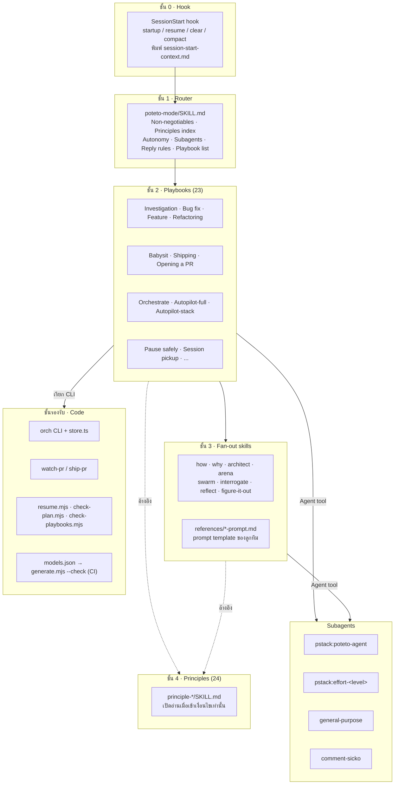

**ทำไมแบ่งชั้น [อนุมาน]**
- **ประหยัด context:** router มีแค่ดัชนีกับเงื่อนไข ส่วนเนื้อหาเต็มของ playbook และ principle โหลดเมื่อใช้เท่านั้น
- **ใช้ซ้ำได้:** playbook หลายตัวเรียก `how`, `architect` และ `arena` ร่วมกัน
- **แก้จุดเดียวได้ผลทั้งระบบ:** แก้ `arena` ครั้งเดียว ทุก playbook ที่เรียกใช้ได้ผลตามไปด้วย

---

## 3. pstack ทำอะไรได้บ้าง: แผนที่ playbook

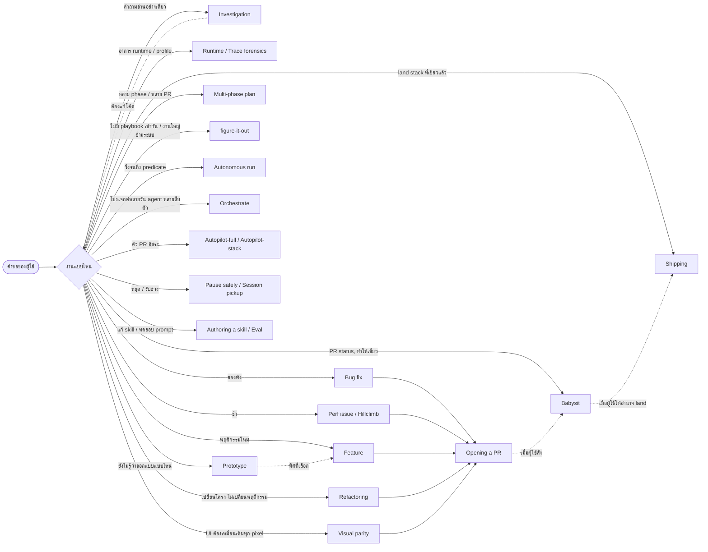

| กลุ่ม | Playbook | แก้ปัญหาอะไร |
|---|---|---|
| เข้าใจโค้ด | Investigation | ตอบคำถามพร้อมแหล่งอ้างอิง ไม่แก้โค้ด |
| แก้ของพัง | Bug fix, Perf issue, Runtime forensics, Trace forensics | หา root cause ด้วยหลักฐานจาก runtime ห้ามเดา |
| สร้างของใหม่ | Feature, Prototype, Visual parity | ออกแบบก่อนเขียน และตัดสินด้วยการทดลองแทนการถามผู้ใช้ |
| ปรับโครงสร้าง | Refactoring | ตรึงพฤติกรรมก่อน แล้ว revert ถ้าไม่คุ้ม |
| ปรับ metric | Hillclimb, Eval | วนทดลองพร้อม decision log |
| งานใหญ่ | Multi-phase plan, figure-it-out, Autonomous run, Orchestrate | แตกงาน ทำ harness ก่อน และวิ่งหลายวันได้ |
| PR lifecycle | Opening a PR, Babysit, Shipping, Autopilot-full, Autopilot-stack | PR → เขียว → land อย่างปลอดภัย |
| ความต่อเนื่อง | Pause safely, Session pickup, Worktree cleanup | หยุดแล้วรับช่วงต่อได้โดยไม่ทำซ้ำ |

---

## 4. ทำจบ flow ได้ไหม: design → dev → test → deploy

**คำตอบ: ทำได้ถึง merge แต่ไม่ deploy** และเขาตั้งใจออกแบบให้หยุดตรงนั้น

```mermaid
flowchart LR
    D["Design<br/>how → architect → interrogate"]:::auto
    V["Dev<br/>delegate ไป subagent ที่มี worktree ของตัวเอง"]:::auto
    T["Test / Verify<br/>driver skill บน surface จริง"]:::auto
    P["Opening a PR<br/>deslop · no-comments · interrogate"]:::auto
    B["Babysit<br/>conflicts → threads → CI จนเป็น READY"]:::ask
    S["Shipping / merge<br/>verifier ต่อ PR + --match-head-commit"]:::ask
    DEP["Deploy"]:::human

    D --> V --> T --> P --> B --> S --> DEP

    classDef auto fill:#d7f5dd,stroke:#2e7d32,color:#111
    classDef ask fill:#fff3c4,stroke:#b28700,color:#111
    classDef human fill:#ffd6d6,stroke:#c62828,color:#111
```

- เขียว คือทำเองได้
- เหลือง คือทำเมื่อผู้ใช้สั่งชัดเจน (Babysit เริ่มเมื่อผู้ใช้ขอ, Shipping ต้องมี "the user's landing authority" และ Autopilot-full ต้องให้คนกด merge เอง)
- แดง คือ pstack ไม่ทำเอง

| ขั้น | ทำได้ไหม | หลักฐานในไฟล์ **[โค้ด]** |
|---|---|---|
| Design | ได้ | Feature ขั้น 1-2 และ `architect` |
| Dev | ได้ | Feature ขั้น 4 "Delegate code-writing to a subagent" |
| Test | ได้ แต่หมายถึงการ verify บนของจริง ไม่ใช่ QA suite | "Verify on the matching surface. Inconclusive or wrong-surface is not a pass." |
| PR | ได้ | `opening-a-pr.md` "Invoked at the end of every other playbook" |
| Babysit | ได้เมื่อผู้ใช้สั่ง | "Babysitting starts when the user asks for it" |
| Merge | ได้เมื่อผู้ใช้ให้อำนาจ | Shipping "requires the user's landing authority", Autopilot-full "the operator's explicit merge click" |
| **Deploy** | **ไม่มี playbook** | Autonomy: "**Always pause** for irreversible writes: force-push to shared branches, deploys, data deletion, customer messages." |

สิ่งเดียวที่ router พูดถึง deploy นอกจากนั้น คือให้โหลด skill ของ platform (Railway, Fly, Vercel, Heroku) ก่อนรัน CLI ของ platform นั้น **[โค้ด]**

**[อนุมาน]** pstack มองว่าขอบเขตของมันคือ "โค้ดที่ verify แล้วเข้า trunk" ส่วน release และ deploy เป็นของ CD หรือของทีม ถ้าต้องการให้ deploy ได้ ต้องเพิ่ม project playbook ใน `.agents/playbooks/` หรือ skill ของ platform เอง และจะยังเป็นจุดที่ต้องหยุดถาม

---

## 5. Flow การเข้าระบบและ routing

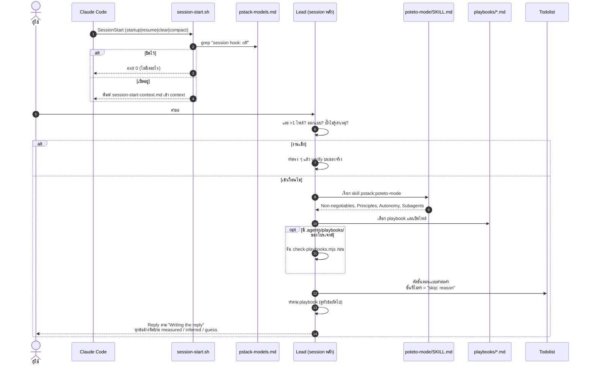

**กฎสำคัญของ router [โค้ด]**
- เกณฑ์การเข้าระบบวัดได้ คือ "touches more than one file, or changes a signature other files call"
- กำลังจะถามผู้ใช้ว่า "ใช้วิธีไหนดี" ให้แยกก่อนว่าคำถามนั้นรันดูคำตอบได้ไหม ถ้าได้ ให้ไป Prototype แทนการถาม
- อ้างถึง principle ได้เฉพาะตัวที่เปิดอ่านไฟล์ใน session นี้แล้ว ("Cite only principles whose leaf SKILL.md you read this session")
- คำสั่งของผู้ใช้ (CLAUDE.md, AGENTS.md) มีลำดับความสำคัญสูงกว่า hook

---

## 6. Flow ของ Feature

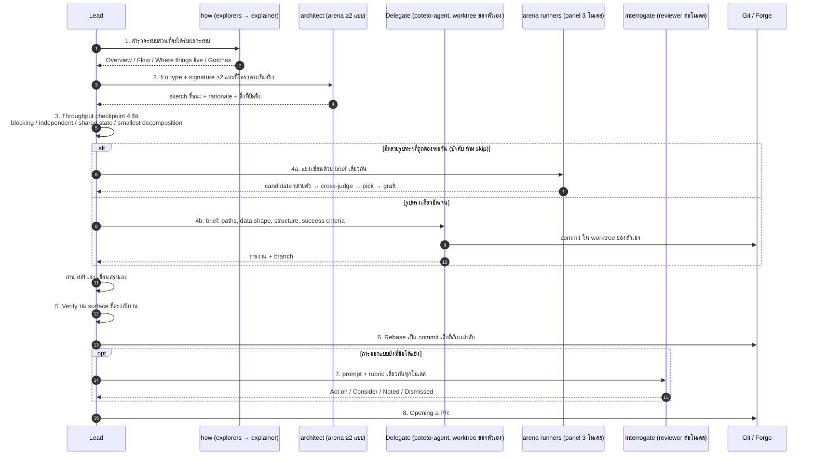

**กฎที่ควรสังเกต [โค้ด]**
- **"Give every file-writing delegate its own worktree"** และ "Fencing a file in the brief's prose is not a lock"
- งานที่โค้ดผูกกันแน่น (feature เดียว หรือ migration เดียว) ให้ owner คนเดียว ที่ fan-out ภายในเองหลังเฟส blocking ส่วนตัวนำ fan-out เองเฉพาะชิ้นที่ให้ artifact อิสระ
- การใช้ `arena` เมื่อมีหลายรูปทรงเป็น "Mandatory: no skip-with-reason escape" เพราะ "the gain is review separation, not lines saved"

---

## 7. Flow ของ Bug fix

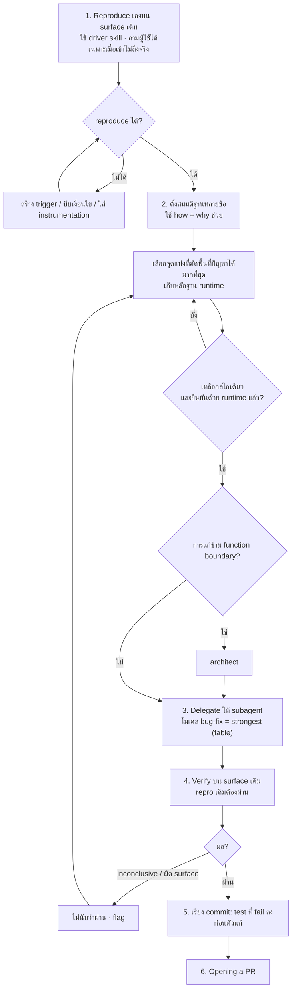

**ปรัชญา [โค้ด]:** "Every shipped line traces to runtime evidence. Belt-and-suspenders that 'might help' is a hypothesis, not a fix. It does not ship. When evidence refutes a hypothesis, revert what it motivated."

---

## 8. รูปแบบการกระจายงาน (fan-out)

ทุก skill มีโครงเดียวกัน คือ **เปิด todolist ตาม phase → Frame → spawn ทุกตัวใน message เดียวแบบ background → รวมผลหรือตัดสิน → Verify → Output ที่มีรูปแบบตายตัว** **[โค้ด]**

### 8.1 `swarm`

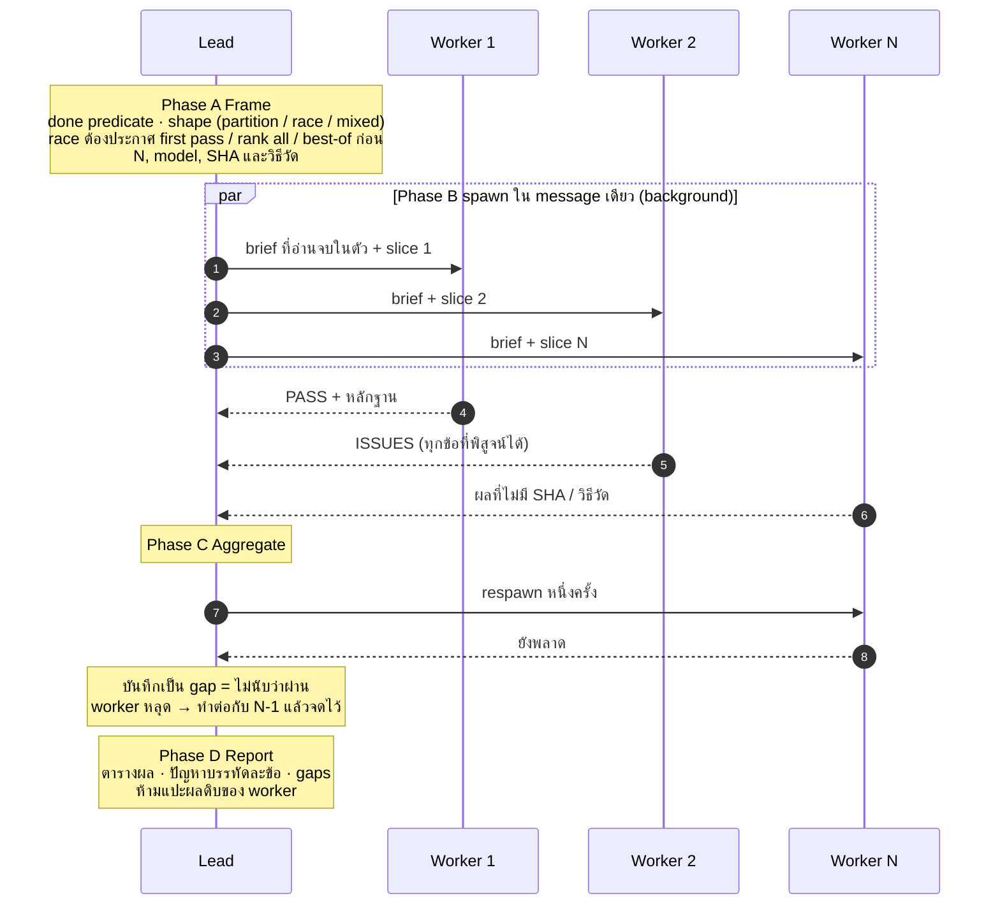

### 8.2 `arena` และ `interrogate`

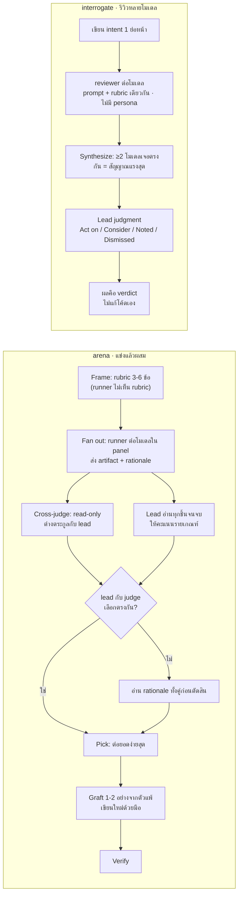

| Skill | Topology | ใช้เมื่อ |
|---|---|---|
| `how` | explorer read-only 2-4 ตัว → explainer 1 ตัว | ทำความเข้าใจโค้ด ถ้าไม่แน่ใจให้ใช้ทางง่าย (explainer ตัวเดียว) |
| `why` | investigator 1 ตัวต่อแหล่งหลักฐาน → synthesizer | หาเหตุผลเบื้องหลัง ผลที่ว่างก็ต้องบันทึก |
| `swarm` | partition / race → aggregate | งานขนานจำนวนมาก |
| `arena` | runner ต่อโมเดล → judge → pick → graft | เมื่อลองครั้งเดียวจะล็อกรูปทรงที่ผิด |
| `architect` | `how` → `arena` แบบ sketch → implement → scrap | ออกแบบข้าม boundary |
| `interrogate` | reviewer ต่อโมเดล → lead ตัดสิน | การออกแบบที่ยังเถียงกันอยู่ |

---

## 9. PR lifecycle: Opening a PR → Babysit → Shipping

### 9.1 State ของ PR หนึ่งตัว

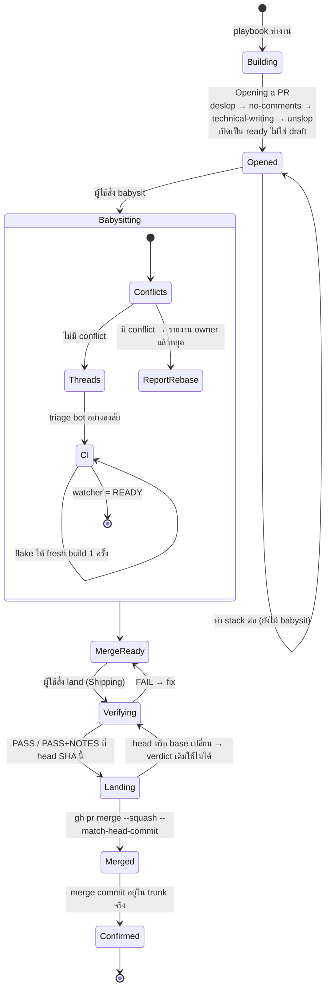

### 9.2 Shipping แบบ sequence

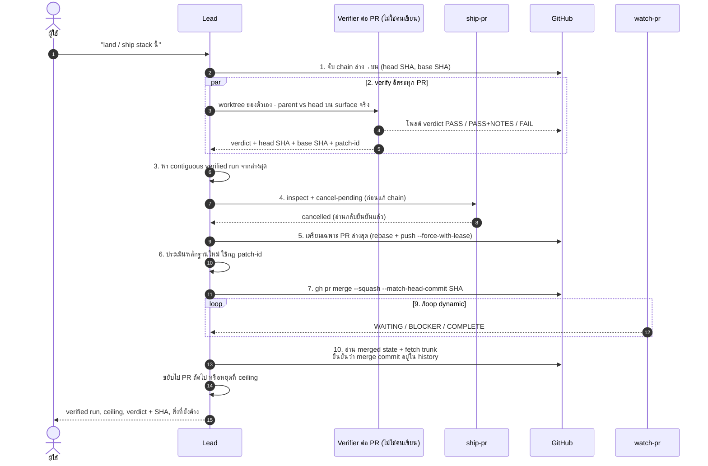

**ทำไมละเอียดขนาดนี้ [โค้ด]**
- "Green is not safe."
- "A last-second read without this condition leaves a race."
- "Polling cannot protect the interval between wakeups."
- "Never use `--admin` to bypass it."

---

## 10. Autopilot-full: owner ต่อ PR

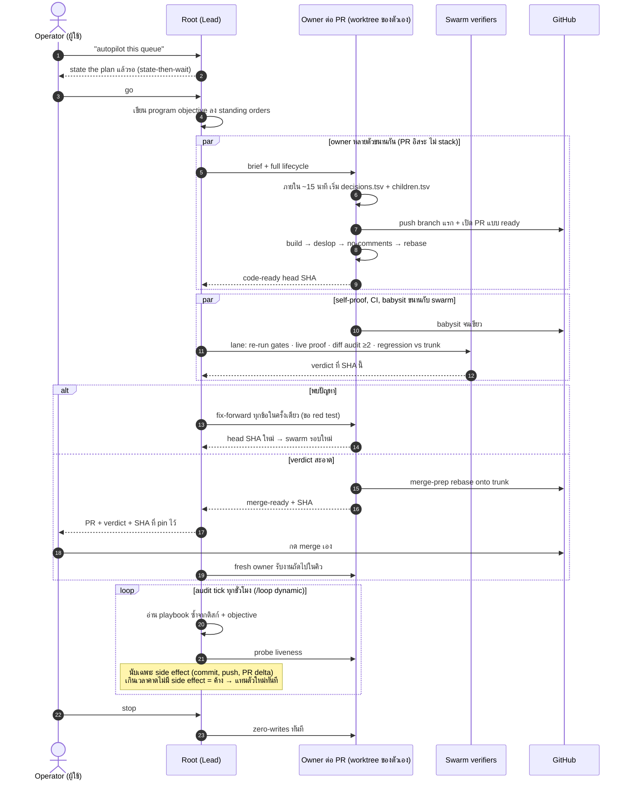

**Autopilot-stack** เหมือนกันแทบทั้งหมด ต่างที่ root เป็น topology writer คนเดียว และส่งมอบเป็น stack เส้นเดียวที่ operator land เอง ("You own the stack, never the landing") **[โค้ด]**

---

## 11. Orchestrate: โปรแกรมหลายวัน

### 11.1 บทบาทและความลึก

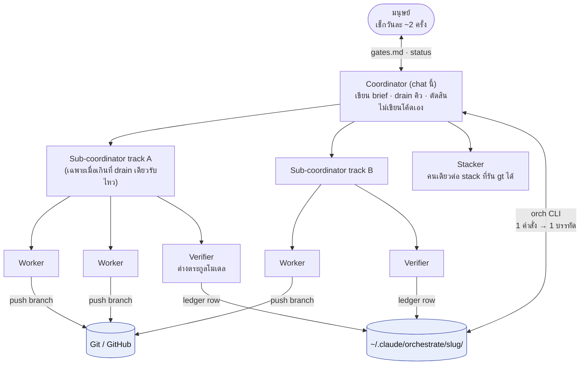

- ความลึกสูงสุดคือ coordinator → track → worker **[โค้ด]**
- worker ที่รันพร้อมกันราว 10 ตัวแบบหน้าต่างเลื่อน **[โค้ด]**
- "The CLI never spawns, waits, or wakes anything." การ spawn ทำผ่าน `Agent` tool เท่านั้น **[โค้ด]**

### 11.2 วงจร queue และ drain

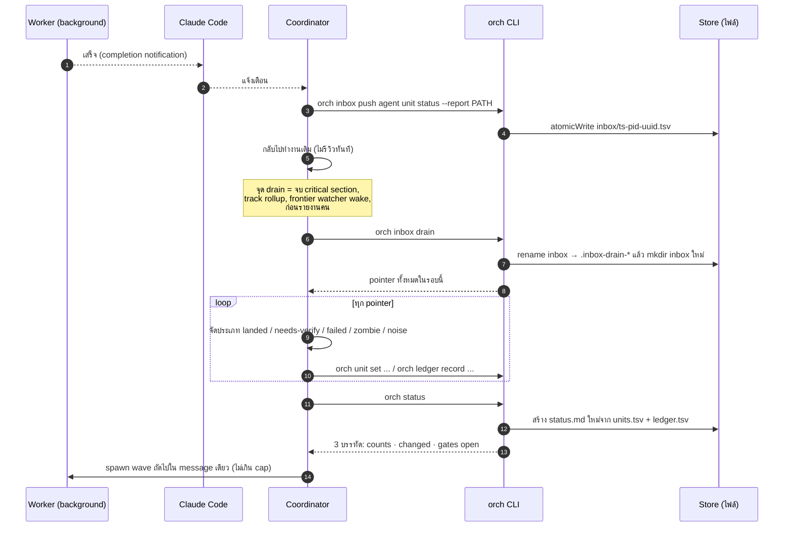

### 11.3 ขั้นตอนของโปรแกรม **[โค้ด]**

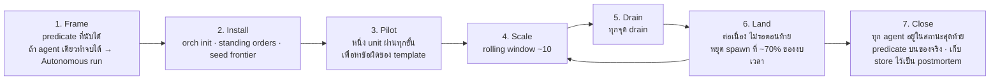

### 11.4 Brief template **[โค้ด]**

```
GOAL         หนึ่งประโยค คนแปลกหน้าที่ไม่เห็นแชตอ่านแล้วทำได้
SCOPE        path ที่เขียนได้ / ห้ามเขียน / worktree หรือ branch ของตัวเอง
CONTEXT      pointer ไปไฟล์และ PR · รายงาน upstream แปะเต็มเมื่อพึ่งพากัน
ACCEPTANCE   เกณฑ์ที่ตรวจได้ บรรทัดละข้อ
VERIFY       คำสั่งตรงตัว หรือ driver skill path + gotcha ที่รู้
TIMEBOX      เพดานเวลา หมดเวลาให้คืนผลบางส่วนแล้วหยุด
FORBIDDEN    no gt, no rebase, no force-push, no fixes outside scope + ข้อห้ามเฉพาะ
REPORT       status, branch, head SHA, PRs, verdict, สิ่งที่รันจริง, ส่วนที่เบี่ยง, follow-up
STANDING     preferences.md แปะแบบคำต่อคำ
```

- "A field you cannot fill is a unit you have not scoped yet." และ "Missing fields are a refuse-to-spawn condition."
- ปรับขนาดให้เท่างาน งานคำสั่งเดียวย่อเหลือย่อหน้าเดียวได้ แต่ยังต้องมี goal, scope, verify และรูปแบบรายงาน

---

## 12. การจัดการ agent

### 12.1 ชนิดของ subagent **[โค้ด]**

| Agent | ไฟล์ | เนื้อหา |
|---|---|---|
| `pstack:poteto-agent` | `agents/poteto-agent.md` | "Read the `poteto-mode` skill's `SKILL.md` in full before doing any work" และเตือนว่า "Substituting `general-purpose` skips that read and drifts" |
| `pstack:poteto-agent-<level>` | `effort-agents/` | เหมือนข้างบน แต่ตั้ง `effort:` ใน frontmatter |
| `pstack:effort-<level>` | `effort-agents/` | ตั้งแค่ `effort:` ใช้แทน `general-purpose` เมื่อ role มี `@level` ส่วนโมเดลผู้เรียกเป็นคนส่ง |
| `general-purpose` | built-in | skill `how`, `why`, `swarm`, `interrogate` เลือกใช้เอง และ lead ห้าม override เป็น `poteto-agent` |
| `comment-sicko` | `agents/comment-sicko.md` | ขอบเขตแคบ ลบได้แค่ comment ห้ามเขียนโค้ดแอป รายงานแล้วจบ |

### 12.2 การเลือกโมเดลต่อ role **[โค้ด]**

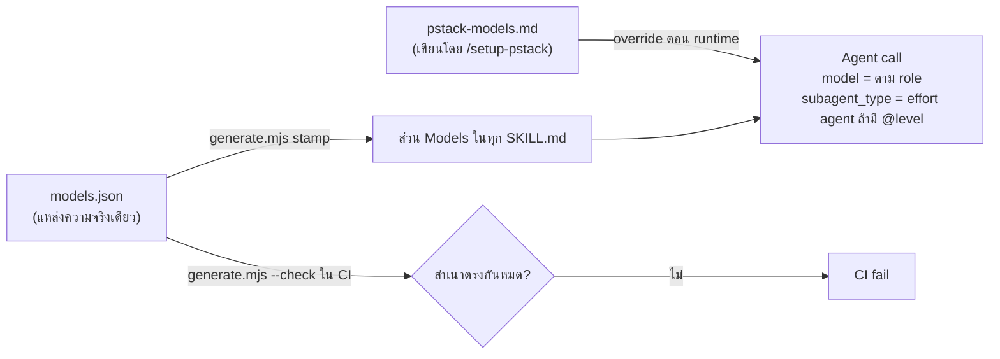

| Tier | โมเดล | Role ที่ใช้ |
|---|---|---|
| `default` | opus | feature, refactoring, how, why, reflect, swarm workers |
| `strongest` | fable | bug-fix, perf-issue, hillclimb, strongest judgment |
| `panel` | opus, fable, sonnet | arena runners, arena cross-judge, architect runners, interrogate reviewers |

### 12.3 วงจรชีวิตของ subagent

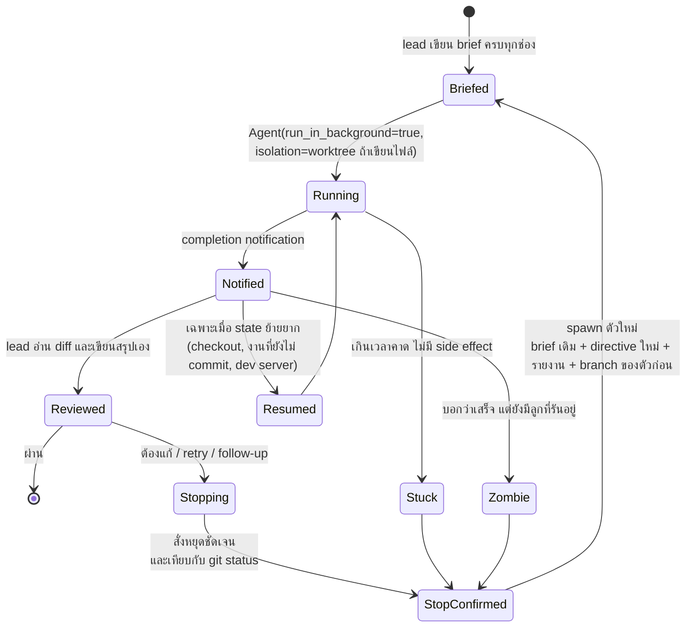

**กฎที่รับน้ำหนัก [โค้ด]**
- **Fresh by default:** "Give new work to a fresh subagent with consolidated scope, meaning the original brief, every later directive, and the prior agent's report and branch."
- **completed ไม่ได้แปลว่าจบ:** "In the agent listing `completed` means the completion was *notified*, not that the process exited."
- **บทบาทอยู่นานกว่า agent:** "A role such as a PR owner outlives its agent."
- **ลูกไม่ได้รับ brief ของพ่อ:** "A delegate's children do not inherit its brief, so a read-only instruction never reaches them."

### 12.4 ความล้มเหลวและการกู้คืน (Orchestrate) **[โค้ด]**

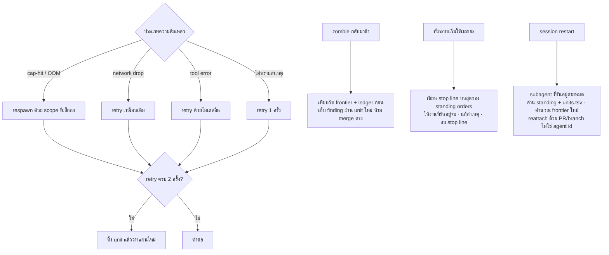

### 12.5 Subagent สื่อสารกันอย่างไร

**subagent ไม่คุยกันเอง และไม่ได้คุยกันผ่านไฟล์** ทุกการสื่อสารวิ่งผ่านตัวนำ ("Keep sibling communication upward only") **[โค้ด]**

ช่องทางมีแค่สองทาง และไม่มีทางไหนเป็นไฟล์
- **ขาไป:** ตัวนำเขียน brief (GOAL, SCOPE, VERIFY, REPORT ฯลฯ) เป็น prompt ตอนเรียก `Agent` tool
- **ขากลับ:** subagent ตอบกลับครั้งเดียวตอนทำเสร็จ แล้ว Claude Code ส่งคำตอบนั้นให้ตัวนำเป็นผลของ tool

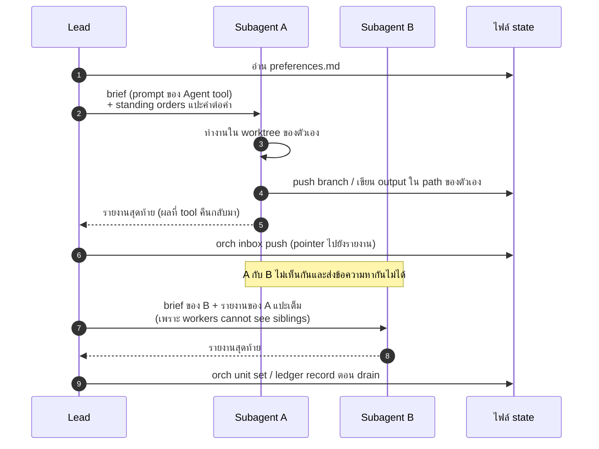

**ถ้างาน B ต้องใช้ผลของงาน A** ตัวนำจะแปะรายงานของ A ลงใน brief ของ B ทั้งก้อน **[โค้ด]**
- "upstream reports pasted in full when this unit depends on them, because workers cannot see siblings"
- "A dependency is a context relay, not just ordering."

**ใครเขียนไฟล์อะไร [โค้ด]**

| ไฟล์ | ใครเขียน | เขียนเมื่อไร |
|---|---|---|
| `inbox/*.tsv` | **ตัวนำ** ผ่าน `orch inbox push` | เมื่อได้รับแจ้งว่า subagent เสร็จ บันทึก agent, unit, สถานะ และ path ของรายงานถ้ามี (`--report PATH`) |
| `units.tsv`, `ledger.tsv` | ตัวนำ หรือ verifier ผ่าน `orch` | ตอน drain และตอนตรวจเสร็จ ("a verifier writes its ledger row") |
| branch ที่ push แล้ว | worker | ทุกครั้งที่ทำหน่วยงานเสร็จ ("A worker pushes its branch") |
| output ของ arena และ swarm | runner หรือ worker | แต่ละตัวมี path หรือ worktree ของตัวเอง |
| `decisions.tsv`, `children.tsv` | owner ใน Autopilot | ระหว่างทำงาน และส่งกลับพร้อมรายงาน |
| `preferences.md` | ตัวนำ | ตัวนำอ่านแล้วแปะลงใน brief โดย subagent ไม่ได้เปิดไฟล์นี้เอง |

**ไฟล์มีไว้ทำอะไร [อนุมาน]:** ไฟล์เป็น state ที่ต้องอยู่รอดหลังจาก agent จบหรือ session ตาย ไม่ใช่ช่องทางแชต และเป็นข้อความธรรมดา (TSV, JSON, Markdown) จึงมีผู้อ่านสองฝ่าย
- **คน** เปิดอ่านได้ตรง ๆ โดยไม่ต้องมีเครื่องมือพิเศษ source เขียนว่า "its canonical plain TSV and JSON stay readable without the CLI" **[โค้ด]**
- **agent ตัวถัดไป** อ่านเพื่อรู้ว่าทำอะไรไปแล้ว เช่น หลัง session restart ตัวนำใหม่อ่าน `preferences.md` กับ `units.tsv` แล้วต่องานจาก PR และ branch ("reattach in-flight work by PR and branch rather than agent id") **[โค้ด]**

### 12.6 มีหน้าเว็บสำหรับ monitor ไหม

**ไม่มี [โค้ด]**
- ใน repo ไม่มีไฟล์ `.html`, `.css`, `.tsx` หรือ `.vue`
- ไม่มีโค้ดที่เปิด web server
- README เขียนว่า "pstack has no server or telemetry"
- คำว่า "status page" ใน `orchestrate.md` หมายถึงไฟล์ `status.md`

สิ่งที่มีไว้ดูสถานะเป็นข้อความทั้งหมด

| ใช้ดูอะไร | ช่องทาง | หน้าตา |
|---|---|---|
| ภาพรวมของโปรแกรม | `~/.claude/orchestrate/<slug>/status.md` | Markdown ที่ `orch status` สร้างใหม่จากตารางทุกครั้ง มี 4 ตาราง คือ Units, Verification ledger, Frontier และ Gates |
| สรุปสั้นตอน drain | `orch status` | 3 บรรทัด คือ counts, สิ่งที่เปลี่ยน และ gate ที่รออยู่ |
| สถานะ PR | `watch-pr` | ค่าเริ่มต้นเป็น JSON และใส่ `--pretty` จะได้ตารางสำหรับคนอ่าน (`render.ts`) |
| การตัดสินใจ | `decisions.tsv` | ดูใน terminal ด้วย `column -s$'\t' -t decisions.tsv` หรือดูบน GitHub ซึ่งแสดง TSV เป็นตาราง |
| agent ที่กำลังรัน | รายการ agent และ task list ของ Claude Code | pstack ไม่ได้สร้างหน้าจอเพิ่ม และห้าม resume agent เพื่อถามสถานะ |

**ข้อแลกของการไม่มีหน้าเว็บ [อนุมาน]**
- **ข้อดี:** ไม่ต้องดูแล server และข้อมูลไม่ออกนอกเครื่อง
- **ข้อเสีย:** ไม่มีภาพรวมแบบ real-time ต้องเปิดไฟล์หรือรันคำสั่งเอง

---

## 13. การเก็บ state ของ agent

**หลักใหญ่: agent ไม่ถือ state** state ทั้งหมดอยู่ในไฟล์และ git มี 7 ชั้น

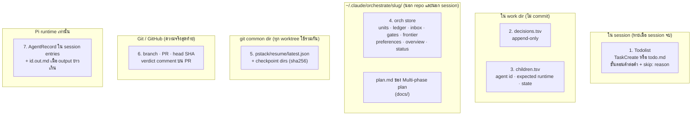

| ชั้น | อยู่ที่ | อยู่รอด restart ไหม | ใครเขียน | กลไกบังคับ **[โค้ด]** |
|---|---|---|---|---|
| 1. Todolist | task tool หรือ `todo.md` | ไม่แน่นอน | lead | **ข้อความเท่านั้น ไม่มี script ตรวจ** |
| 2. `decisions.tsv` | work dir | ได้ ถ้าไฟล์ยังอยู่ | agent ที่ทำ run นั้น | `log.sh` ล้าง tab/newline และกัน formula injection |
| 3. `children.tsv` | work dir ของ owner | ได้ | owner | ข้อความ ใช้ใน audit tick |
| 4. orch store | `~/.claude/orchestrate/<slug>/` | ได้ | หนึ่งไฟล์มี writer คนเดียว | `store.ts` เขียนแบบ atomic และมี lock แบบ PID |
| 5. Checkpoint | `<git-common-dir>/pstack/resume/` | ได้ (ยกเว้นลบ repo) | lead ตอน pause | `resume.mjs` ตรวจ hash และลิงก์ |
| 6. Git/forge | remote | ได้ | worker push, stacker แก้ topology | `--match-head-commit`, `--force-with-lease` |
| 7. Pi record | session ของ Pi | ได้ | extension | schema + process check |

### 13.1 Orchestrate store แบบละเอียด

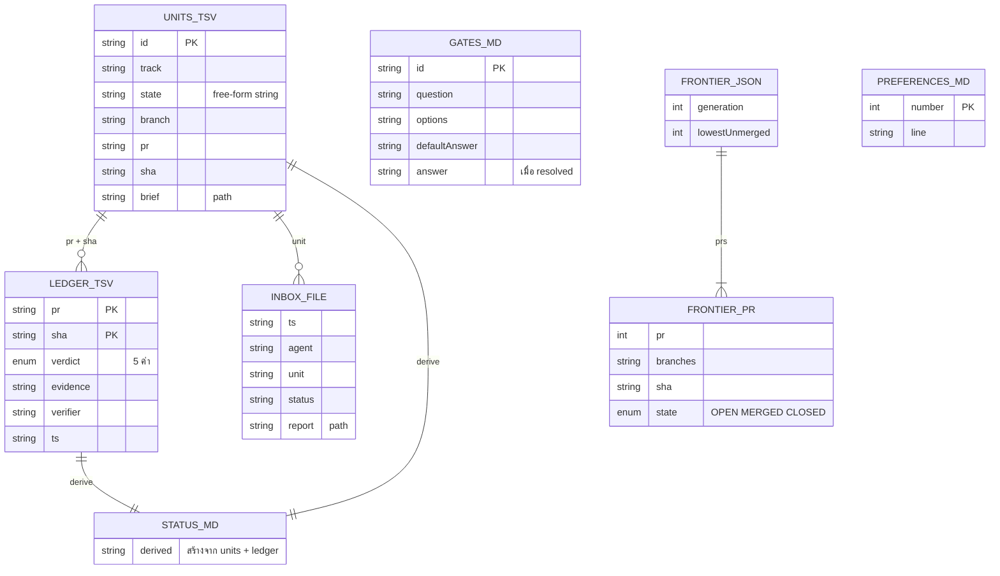

| ไฟล์ | หน้าที่ | กฎการเขียน |
|---|---|---|
| `preferences.md` | standing orders บรรทัดเลขที่ หนึ่งข้อจำกัดต่อบรรทัด | แปะคำต่อคำทุก spawn/resume คำตัดสินของคนต้องเก็บถ้อยคำเดิมและผู้พูด |
| `overview.md` | ฐานข้อมูล PR และ issue | append ห้ามเขียนใหม่ทั้งไฟล์ |
| `units.tsv` | หนึ่งแถวต่อหน่วยงาน | แก้แถวในที่ (`orch unit set`) |
| `ledger.tsv` | verdict ต่อ PR+SHA | `orch ledger record` ถ้า key ซ้ำจะแทนแถวเดิม |
| `inbox/` | pointer ของงานที่เสร็จ หนึ่งไฟล์ต่อ event | `push` เขียนไฟล์ใหม่, `drain` ใช้ rename |
| `gates.md` | คำถามที่รอคน พร้อมค่าเริ่มต้นถ้าไม่ตอบ | `orch gate park/resolve` |
| `frontier.json` | PR ตามลำดับ, SHA, generation, lowest unmerged | คำนวณใหม่หลัง merge หรือ restack |
| `decisions.tsv` | decision trail | append-only |
| `status.md` | สรุปสถานะ | **สร้างจากตารางเสมอ ห้ามเขียนมือ** |

### 13.2 กลไกในโค้ด `store.ts` **[โค้ด]**

```mermaid
sequenceDiagram
    autonumber
    participant CLI as orch (process A)
    participant LK as .orch.lock
    participant TMP as .name.pid.uuid.tmp
    participant F as units.tsv

    CLI->>LK: open(path, "wx") เขียน PID
    alt มี lock อยู่แล้ว
        CLI->>LK: อ่าน PID ของเจ้าของ
        CLI->>CLI: process.kill(pid, 0)
        alt ESRCH (เจ้าของตายแล้ว)
            CLI->>LK: unlink แล้วสร้างใหม่ (onStaleLock)
        else ยังมีชีวิต
            CLI-->>CLI: error "store lock held by pid N"
        end
    end
    CLI->>F: อ่านทั้งไฟล์
    CLI->>CLI: แก้แถวในหน่วยความจำ
    CLI->>TMP: writeFile(flag "wx")
    CLI->>F: rename(tmp → units.tsv)  (atomic)
    CLI->>LK: unlink เฉพาะเมื่อ PID ในไฟล์เป็นของตัวเอง
```

- **Atomic write:** เขียนไฟล์ชั่วคราวที่มี pid และ uuid แล้ว `rename` ทับ ไฟล์จึงไม่มีวันเหลือครึ่ง ๆ
- **Lock ที่กู้ตัวเองได้:** "The dead session's store lock clears itself on the next write."
- **Drain ที่ไม่ทำข้อความหาย:** `rename(inbox → .inbox-drain-<pid>-<uuid>)` แล้ว `mkdir inbox` ใหม่ ข้อความที่มาระหว่าง drain จะลงโฟลเดอร์ใหม่และรอรอบถัดไป
- **Verdict ผูกกับ SHA:** `ledger.check(pr, sha)` หาไม่เจอจะคืน `NOT-VERIFIED` ทันที SHA ใหม่จึงไม่มีทางได้ผลของ SHA เก่า
- **Verdict เป็น enum:** `live-ui-verified | unit-test-verified | type-check-only | verifier-blocked | verifier-failed` ค่าอื่นถูกปฏิเสธ
- **จุดที่หลวม:** `units.set` รับ `state` เป็น string อะไรก็ได้ ไม่มี state machine และไม่ตรวจลำดับการเปลี่ยนสถานะ

### 13.3 Decision trail (`show-me-your-work`) **[โค้ด]**

```
ts	phase	decision	why	evidence	result
```

- แถวละหนึ่งการตัดสินใจ cell บรรทัดเดียว evidence เป็น pointer (SHA, PR, `file:line`)
- **Append-only:** แถวที่ผิดให้เพิ่มแถวใหม่ทับ ห้ามแก้หรือลบ
- **แถว `start`:** run ใหม่ที่มาเขียนต่อ log เดิมต้องขึ้นแถว `start` ที่ระบุช่วง `ts` ที่ตัวเองไม่ได้เขียน
- **ตรวจกับ transcript:** ตอนจบ ให้ไล่แถวของ run นี้เทียบกับ transcript ถ้าพบการตัดสินใจที่ไม่ได้บันทึก ให้เพิ่มแถว
- **Cross-model review:** spawn subagent ต่างตระกูลโมเดลมาอ่าน trail กับ transcript แล้วคำตอบต้องจบด้วยหัวข้อ "Attention" ที่ขึ้นต้นด้วย `reviewed by <model>`

### 13.4 Pi: runtime ที่เขาสร้าง subagent เอง **[โค้ด]**

```mermaid
stateDiagram-v2
    [*] --> running: spawn<br/>identity ถูกตรึง (id, model, sessionId, worktree)<br/>record มี pid + parentPid
    running --> completed: process จบ + มีคำตอบสุดท้าย + ไม่มี error
    running --> failed: process จบแบบอื่น
    running --> stopped: ถูกสั่งหยุด
    running --> stopped: restore แล้วไม่พบ process ของ session นี้
    completed --> [*]
    failed --> [*]
    stopped --> [*]
```

- ทุกครั้งที่สถานะเปลี่ยน จะ `pi.appendEntry(ENTRY_TYPE, record)` เก็บเป็น snapshot ใน session และตอนเปิดใหม่ `restore()` จะไล่อ่าน snapshot กลับมา
- ก่อน kill จะตรวจว่า process ที่ PID นั้นยังรัน `--session-id` ของ agent ตัวนี้อยู่จริง เพราะ PID อาจถูกใช้ซ้ำ
- output ที่ยาวเกินจะถูกตัดใน context แต่ฉบับเต็มเขียนไว้ที่ `<id>.out.md`

---

## 14. Pause และ Session pickup

```mermaid
sequenceDiagram
    autonumber
    participant A as Agent (session เดิม)
    participant G as Git
    participant RM as resume.mjs
    participant CP as git-common-dir/pstack/resume/
    participant B as Agent (session ใหม่)

    Note over A: Pause safely
    A->>A: 1. หยุดที่ขอบเขตปลอดภัย ยกเลิก subagent ซ้อน
    A->>G: 3. commit "wip:" หนึ่ง commit
    A->>RM: resume.mjs begin --project worktree
    RM-->>A: checkpoint dir ใหม่
    A->>CP: เขียน resume.md + artifact ที่ผู้ใช้ขอ
    A->>RM: publish --note resume.md --artifact ...
    RM->>RM: ตรวจว่าไฟล์อยู่ใน project, ลิงก์ครบ, คำนวณ sha256
    RM->>CP: แทน latest.json แบบ atomic
    A->>RM: read (ตรวจอ่านกลับ)

    Note over B: Session pickup
    B->>RM: resume.mjs read --project worktree
    alt kind checkpoint (exit 0)
        RM-->>B: note + artifacts (ตรวจ hash ซ้ำ)
    else kind missing (exit 2)
        B->>B: fallback: transcript ของ workspace นี้เท่านั้น / branch / cloud URL
    else kind unavailable (exit 1)
        B->>B: วินิจฉัยช่องว่าง ห้ามข้ามแบบเงียบ
    end
    B->>G: 2. สร้างสถานะกลับ: branch, git log, diff vs base
    B->>B: 3. เทียบ done กับ pending ห้ามทำซ้ำงานที่เสร็จแล้ว
    B->>B: 4. route ไป playbook ที่เหมาะ
    B->>B: 5. verify ของที่รับช่วงบนของจริง<br/>(รายงานที่ตัวก่อนบอกว่าผ่าน ไม่ถือเป็นหลักฐาน)
```

**จุดออกแบบ [โค้ด]**
- เก็บไว้ใน git common dir ทุก worktree ของ repo เดียวกันจึงหาเจอ และ git ไม่ commit ไฟล์เหล่านี้
- ไฟล์ checkpoint ที่ publish แล้วถือว่าแก้ไม่ได้ pause ครั้งต่อไปต้องใช้ directory ใหม่
- "The pointer is a locator, not a task scheduler or execution lock."

---

## 15. ระบบ verify และ verdict

| ระดับ | ชุดคำ | ใช้ที่ | กฎ **[โค้ด]** |
|---|---|---|---|
| Worker ใน swarm | `PASS` / `ISSUES` / `BLOCKED` | `swarm` | ต้องมีหลักฐาน และรายงานทุกข้อบกพร่องที่พิสูจน์ได้ |
| Workflow | `VERIFIED` / `NOT VERIFIED` / `INCONCLUSIVE` | `figure-it-out` | "Inconclusive is not a pass. Don't hide a negative." |
| Ledger | `live-ui-verified` … `verifier-failed` | Orchestrate | key = PR + head SHA, SHA ใหม่ทำให้ผลเดิมใช้ไม่ได้ |
| Shipping | `PASS` / `PASS+NOTES` / `FAIL` | Shipping | ผู้ตรวจต้องไม่ใช่ผู้เขียน และ CI เขียวไม่แทน verdict |
| Watcher | `READY` / `WAITING` / `ADVANCE` / `COMPLETE` / `BLOCKER` / `TIMEOUT` | `watch-pr` | เป็น type ใน `types.ts` และ "unknown state never permits a merge" |
| คำตอบถึงผู้ใช้ | measured / inferred / guess | router | ทุกข้ออ้างต้องมีป้ายในประโยคเดียวกัน |

```mermaid
flowchart LR
    W["Worker self-report"] -->|เขียนได้| L[("ledger<br/>PR + SHA")]
    V["Verifier<br/>ต่างตระกูลโมเดล"] -->|override บน key เดียวกัน| L
    CI["CI green"] -.->|เป็นแค่ input| V
    L --> Q{"ledger check<br/>PR + head SHA ปัจจุบัน"}
    Q -->|ไม่พบ| NV["NOT-VERIFIED"]
    Q -->|type-check-only| BH["ไม่พอสำหรับงานที่เป็นพฤติกรรม"]
    Q -->|verifier-blocked| RB["ไม่ใช่ pass · respawn เมื่อ env ฟื้น"]
    Q -->|verifier-failed| FX["fix unit ไม่ใช่ re-verify"]
    Q -->|live-ui / unit-test verified| OK["land ได้"]
```

**ปรับระดับการ verify ให้เท่ากับงาน [โค้ด]:** "A verifier agent whose entire product would be rerunning one command is ceremony, not verification." ถ้า VERIFY เป็นคำสั่งเดียวที่ถูก ให้ worker รันแล้วแนบ output และ coordinator สุ่มตรวจ

---

## 16. ทำไมเขาออกแบบแบบนี้

### 16.1 เหตุผลที่เขาเขียนไว้เอง **[โค้ด]**

| การออกแบบ | เหตุผลในไฟล์ |
|---|---|
| Fresh subagent แทนการ resume | "Interrupt-chained resumes silently drop directives" |
| แปะ standing orders ทุกครั้ง | "Directives decay across resumes, and each dropped one costs a human turn" |
| Brief ต้องครบทุกช่อง | "A vague brief fails quietly, because a worker cannot ask you a question" |
| Worktree ต่อ writer | "Fencing a file in the brief's prose is not a lock" |
| Store นอก session | "The store has to outlive this chat… The session scratchpad is not a candidate" |
| ห้าม resume เพื่อเช็กสถานะ | "Never resume an agent to check on it. A resume restarts an idle agent." |
| จำกัดความลึก | "Each nested layer re-pays a full orientation preamble, and a blocking sub-coordinator hides its children while the parent idles" |
| หน้าต่างเลื่อน | "Blocking batches pay the slowest child of every batch" |
| ไม่ fix โครงทีมตายตัว | "Hard-coded swarm trees were tried and parked as too rigid" |
| Completion เป็น event ในคิว | "Completions are queue events, not interrupts" และ "Never review a diff inside a drain" |
| CI ไม่ใช่ verdict | "CI green is an input to a verdict, not a verdict" |
| ทำงานให้ออกนอกเครื่องทันที | "Work that exists only on one VM when that VM dies was never done" |
| Merge แบบมีเงื่อนไขฝั่ง server | "A last-second read without this condition leaves a race" |
| Babysit ไม่เริ่มเอง | "A babysit for each new PR stalls the build and spends checks on commits that later waves restart" |
| `poteto-agent` ต้องอ่าน `SKILL.md` | "Substituting `general-purpose` skips that read and drifts" |
| พิธีต้องเท่ากับงาน | "Ceremony must scale with the program" |
| Lesson ที่เจอซ้ำต้องเป็นโครงสร้าง | "You catch yourself writing the same instruction a second time. Encode it as a lint, metadata flag, runtime check, or script" |

### 16.2 ปรัชญาเบื้องหลัง **[อนุมาน]**

```mermaid
mindmap
  root((pstack))
    ไม่เชื่อ agent
      completed ไม่ได้แปลว่าจบ
      รายงานไม่ใช่หลักฐาน
      verdict ผูกกับ SHA
      ผู้ตรวจไม่ใช่ผู้ทำ และต่างตระกูลโมเดล
    agent ไร้สถานะ
      brief ครบในตัว
      fresh by default
      state อยู่ในไฟล์และ git
      บทบาทอยู่นานกว่า agent
    คนถือสิ่งที่ย้อนกลับไม่ได้
      merge ต้องได้อำนาจ
      deploy หยุดถามเสมอ
      งานที่ย้อนได้ทำเลย ไม่ถาม
    ความหลากหลายสร้างสัญญาณ
      panel 3 โมเดล
      ไม่ใช้ persona
      เห็นตรงกันคือสัญญาณแรง
    บังคับด้วยโครงสร้าง
      generator + CI
      orch store
      watch-pr policy
      check-plan
    ประหยัด context
      router เป็นดัชนี
      ส่ง pointer
      งานใหญ่ส่ง subagent
```

1. **ไม่เชื่อ agent:** ทั้งคำว่า "เสร็จ", ความจำ และรายงาน ความจริงจึงอยู่ที่ git SHA, ไฟล์ที่เขียนแบบ atomic และผลที่ตรวจโดยตัวที่ไม่ได้ทำงานนั้น
2. **Agent เป็นฟังก์ชันไร้สถานะ:** รับ brief ครบ คืนผลหนึ่งก้อน แล้วจบ lead และไฟล์เป็นผู้ถือ state
3. **คนเป็นเจ้าของสิ่งที่ย้อนกลับไม่ได้:** เหตุนี้เองที่ทำให้ flow ไม่ไปจนถึง deploy
4. **ความหลากหลายของโมเดลแทนการสร้าง persona:** ความเห็นต่างมาจากโมเดลที่ต่างกันจริง ไม่ใช่จากบทบาทที่สมมติขึ้น
5. **เมื่อพลาดซ้ำ ให้ย้ายกฎจากข้อความไปเป็นโค้ด**

---

## 17. ข้อจำกัดที่เห็นจาก source

| ข้อจำกัด | หลักฐาน |
|---|---|
| Todolist คำต่อคำไม่มีตัวตรวจ | กฎอยู่ใน `SKILL.md` แต่ไม่มี script ตรวจว่าคัดมาครบ **[โค้ด]** |
| State ของ unit ไม่มี state machine | `units.set` รับ `state` เป็น string อิสระ **[โค้ด]** |
| ต้นทุน context สูง | `poteto-agent` ทุกตัวต้องอ่าน `SKILL.md` ทั้งไฟล์ก่อนเริ่ม **[โค้ด]** |
| ผูกกับ GitHub | `watch-pr` เป็นของ GitHub ส่วน Origin ใช้คำสั่งของมันเอง **[โค้ด]** |
| ไม่มี deploy | ไม่มี playbook และอยู่ในรายการ Always pause **[โค้ด]** |
| Subagent คุยกันเองไม่ได้ | "Keep sibling communication upward only" **[โค้ด]** |
| ไม่มี telemetry | README "pstack has no server or telemetry" ต้องวัดต้นทุนเอง **[โค้ด]** |
| กฎส่วนใหญ่เป็นข้อความ | ความน่าเชื่อถือขึ้นกับว่า model ทำตามหรือไม่ **[อนุมาน]** |

---

## 18. นำไปประยุกต์กับ subagent ของคุณ

ส่วนนี้เทียบกับทีมใน `.agents/` ของ repo นี้ (lead, analyst, backend, frontend, spec-reviewer, qa, git) ทั้งหมดเป็น **[ข้อเสนอ]**

### 18.1 สิ่งที่ทีมของคุณแน่นกว่า pstack อยู่แล้ว

| เรื่อง | ทีมของคุณ | pstack |
|---|---|---|
| สถานะงาน | `task.py` คุมสถานะและบทบาทผู้เปลี่ยน (`--by`) | `units.tsv` state เป็น string อิสระ |
| คำอนุมัติของผู้ใช้ | ต้องพบถ้อยคำของผู้ใช้ใน prompt log | "Always pause" เป็นข้อความ |
| สิทธิ์ของ role | hook ตรวจ role ของผู้รัน script | ไม่มีการตรวจ role |
| ลูปซ้ำ | loop guard | ไม่มี |
| Commit gate | ต้อง PASS สำหรับ tree ที่ stage | `--match-head-commit` ตอน merge |

### 18.2 สิ่งที่น่าหยิบจาก pstack

| # | หลักการจาก pstack | วิธีนำไปใช้ |
|---|---|---|
| 1 | **Brief ครบทุกช่อง ไม่ครบห้าม spawn** | เพิ่มช่อง `FORBIDDEN`, `TIMEBOX` และ `REPORT` ใน task brief แล้วให้ `job.py add-task` ปฏิเสธเมื่อมีช่องว่าง |
| 2 | **Standing orders แปะทุก spawn** | ทำ `standing.md` ของแต่ละ job (ข้อห้ามและคำตัดสินของผู้ใช้แบบคำต่อคำ) ให้ lead แปะทุก brief และให้ script ตรวจว่ามีอยู่ |
| 3 | **Fresh subagent ต่อรอบแก้** | เขียนใน protocol ว่ารอบแก้ทุกรอบต้อง spawn ใหม่ โดยส่ง brief เดิม + fix task + รายงานรอบก่อน + branch |
| 4 | **Verdict ผูกกับ revision** | ทำอยู่แล้วด้วย tree id ให้คงไว้และขยายไปถึง spec-review: tree id ใหม่ทำให้ review เดิมใช้ไม่ได้ |
| 5 | **ผู้ตรวจต่างตระกูลโมเดล** | ถ้า backend ใช้ sonnet ให้ spec-reviewer หรือ qa ใช้ opus หรือ fable (เปลี่ยน `models.json` ต้องให้ผู้ใช้อนุมัติ) |
| 6 | **ผลว่างเป็นผลที่ถูกต้อง** | ใส่ใน `spec-reviewer.md` ว่า "ไม่มี finding เป็นผลที่ถูกต้อง" เพื่อกันการแต่ง fix task |
| 7 | **Gap ไม่ใช่ pass** | ใส่ใน qa: เกณฑ์ที่รันไม่ได้ให้บันทึกเป็น gap ใน test report และนับว่าไม่ผ่าน |
| 8 | **Completion เป็น event ในคิว** | ให้ teammate เขียนรายงานลงไฟล์ใน job dir (`reports/<task>-<role>-<ts>.md`) แล้ว lead อ่านจากไฟล์ ไม่ใช่จากข้อความที่ส่งกลับมา |
| 9 | **Status คำนวณจากตาราง** | ให้ `job.py status` สร้างสรุปจาก task files เสมอ และห้ามเขียนสรุปสถานะด้วยมือ |
| 10 | **Atomic write + lock แบบ PID** | ใช้ pattern `tmp + rename` และ lock ที่ตรวจว่าเจ้าของยังมีชีวิตอยู่ใน `job.py` และ `task.py` ถ้ายังไม่ได้ทำ |
| 11 | **Checkpoint ที่ตรวจ hash** | เพิ่ม `job.py pause` ที่เขียน resume note พร้อม sha256 ของ artifact และให้ `job.py resume` ตรวจ hash ก่อนเชื่อ |
| 12 | **Liveness จาก side effect** | ตรวจว่า teammate ค้างหรือไม่จาก task status หรือไฟล์ที่เปลี่ยน ไม่ปลุก agent ขึ้นมาถาม |
| 13 | **Decision trail ที่ append-only** | `decisions.tsv` ต่อ job ใช้คู่กับ `job.py decide` และให้โมเดลอื่นรีวิวตอนจบ |
| 14 | **ปรับพิธีให้เท่ากับงาน** | กำหนดเกณฑ์ว่างานแบบไหนข้าม spec-reviewer ได้ เช่น แก้ไฟล์เดียวที่มี test ชัด (เป็นการเปลี่ยน gate ต้องถามผู้ใช้) |

### 18.3 ภาพเป้าหมาย: ทีมของคุณ + หลักของ pstack

```mermaid
sequenceDiagram
    autonumber
    actor U as ผู้ใช้
    participant LD as Lead
    participant JS as job.py / task.py
    participant FS as job dir (reports, decisions.tsv, standing.md)
    participant IM as backend / frontend (fresh, worktree)
    participant SR as spec-reviewer (ต่างตระกูลโมเดล)
    participant QA as qa
    participant GT as git

    U->>LD: grill → ยืนยัน → G1 approve
    LD->>JS: add-task (ปฏิเสธถ้า brief ไม่ครบ)
    LD->>IM: brief + standing.md คำต่อคำ
    IM->>JS: task → implemented
    IM->>FS: reports/T-01-backend.md
    LD->>FS: อ่านรายงานจากไฟล์ + อ่าน diff เอง
    LD->>GT: stage → tree id
    LD->>SR: review ที่ tree id นี้
    SR->>FS: reviews/ (ผลว่างได้) หรือ fixes/
    alt มี fix task
        LD->>IM: spawn ตัวใหม่: brief เดิม + fix + รายงานก่อน
    else ไม่มี
        LD->>QA: verify ที่ tree id เดียวกัน
        QA->>FS: evidence + test-report (gap = ไม่ผ่าน)
    end
    LD->>GT: commit ผ่าน commit gate (PASS ของ tree นี้)
    LD->>FS: decisions.tsv + cross-model review
    LD-->>U: สรุป + path ของ test-report
    Note over U,GT: push / merge / deploy ยังต้องถามผู้ใช้เสมอ
```

### 18.4 ลำดับที่แนะนำ
1. ข้อ 1, 2, 6, 7 แก้แค่ template และไฟล์ agent ต้นทุนต่ำ แต่ได้ผลทันที
2. ข้อ 3, 8, 9 เปลี่ยน protocol ของ lead
3. ข้อ 10, 11, 12 เพิ่มโค้ดใน `job.py`/`task.py` พร้อม test
4. ข้อ 5 และ 14 เป็นการเปลี่ยน model profile หรือ gate ตาม `AGENTS.md` ต้องให้ผู้ใช้อนุมัติก่อน

---

## 19. แผนที่ไฟล์ต้นฉบับ

| เรื่อง | ไฟล์ใน `pstack-claude-main/` |
|---|---|
| ภาพรวมและศัพท์ | `README.md`, `CONTEXT.md` |
| Hook | `plugins/pstack/hooks/hooks.json`, `session-start.sh`, `session-start-context.md` |
| Router | `plugins/pstack/skills/poteto-mode/SKILL.md` |
| Playbook | `plugins/pstack/skills/poteto-mode/playbooks/*.md` |
| นิยาม agent | `plugins/pstack/agents/`, `plugins/pstack/effort-agents/` |
| นโยบายโมเดล | `plugins/pstack/models.json`, `tools/generate.mjs` |
| Orchestrate store | `plugins/pstack/skills/poteto-mode/scripts/orch/store.ts`, `orch.ts`, `orch.test.ts` |
| PR watcher และ shipping | `plugins/pstack/skills/poteto-mode/scripts/watch-pr/` (`policy.ts`, `types.ts`, `shipping.ts`) |
| Checkpoint | `plugins/pstack/skills/poteto-mode/scripts/resume.mjs`, `references/resume-storage.md` |
| Merge safety | `plugins/pstack/skills/poteto-mode/references/merge-safety.md` |
| Decision trail | `plugins/pstack/skills/show-me-your-work/SKILL.md`, `scripts/log.sh` |
| Fan-out | `plugins/pstack/skills/{how,why,swarm,arena,architect,interrogate,reflect,figure-it-out}/` |
| Pi runtime | `plugins/pstack/pi/agents.ts`, `child.ts`, `worktree.ts` |
| Tests | `tests/*.test.mjs`, `tests/pi/` |
